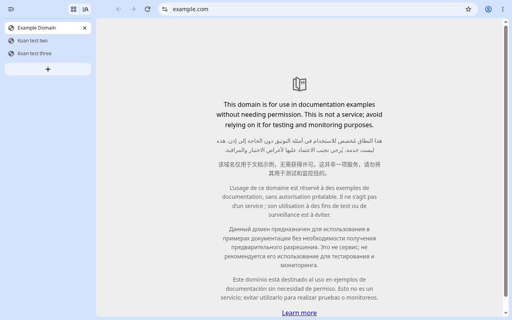
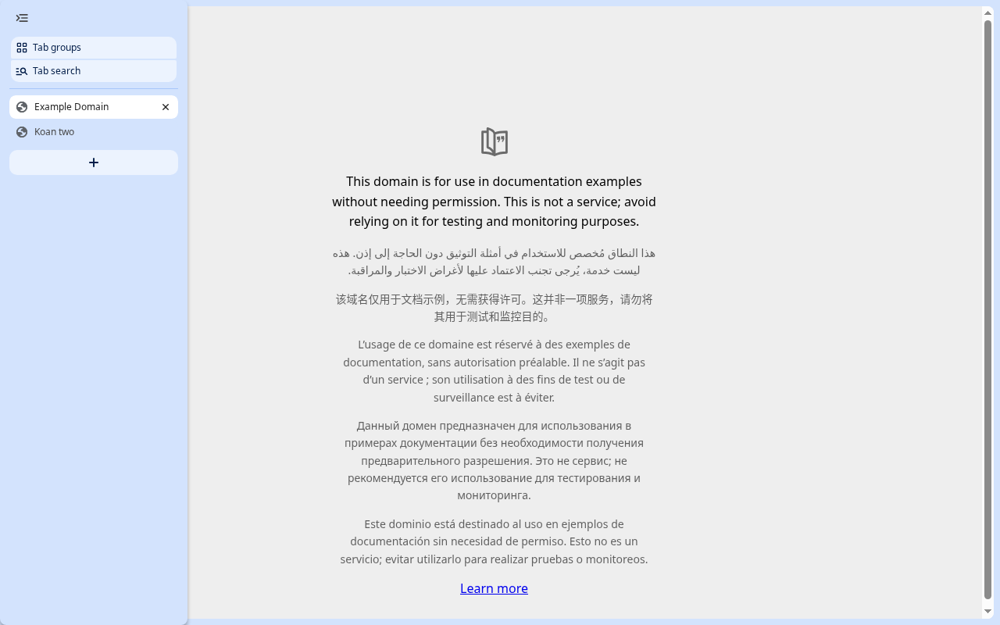
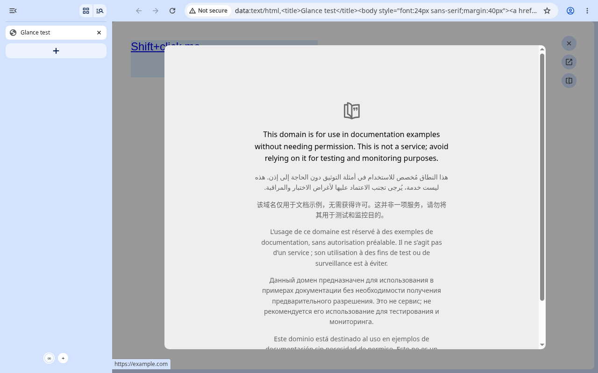

# Koan

A Chromium browser with Zen's UX: tabs in a sidebar, the page as a floating
card, workspaces, Essentials, Glance, split view and compact mode. The UI is
native C++ (Chromium Views, compositor-driven animations); the engine is
plain Chromium, so rendering, animations and DevTools behave exactly as in
Chrome.

See [docs/USAGE.md](docs/USAGE.md) for features and shortcuts.

| Zen look | Compact mode | Glance |
|---|---|---|
|  |  |  |

## How it's built

- Koan code lives in `src/`, symlinked as `chromium/src/koan` (GN `//koan`).
- Upstream Chromium gets small hook patches (`patches/`, one per file, a few
  lines each) that call into `//koan`; `scripts/apply_patches.sh` applies,
  checks, reverses and exports them.
- Branding (name, logos) is applied by `scripts/apply_branding.sh`.
- Every Koan feature is a `base::Feature` with a `chrome://flags` switch.
- Upstream building blocks: vertical tabs, tab group focus mode
  (workspaces), split view, the NonClientView overlay (compact toolbar).

```
koan/
├── src/           Koan C++ (//koan): features, prefs, views controllers
├── patches/       hook patches for chromium/src, one per upstream file
├── branding/      logo sources (SVG); rendered into chromium/src on apply
├── build/koan.gn  GN args
├── scripts/       bootstrap, build, patches, branding, tests, desktop entry
├── docs/          plan, designs, research, usage, rebase guide
├── depot_tools/   (ignored) Chromium tooling
└── chromium/      (ignored) Chromium checkout
```

## Building

```sh
./scripts/bootstrap.sh          # depot_tools + Chromium checkout + hooks (long)
./scripts/apply_patches.sh      # link //koan, apply hook patches
./scripts/apply_branding.sh     # Koan name and logos
JOBS=4 ./scripts/build.sh       # development build: out/Koan/chrome
KOAN_CONFIG=release ./scripts/build.sh   # release build: out/Release/chrome
./scripts/install_desktop.sh    # optional: app menu entry
```

The first build takes 10–15 hours on an 8-core / 16 GB machine; Koan-only
changes rebuild in a couple of minutes. Updating Chromium:
[docs/REBASE.md](docs/REBASE.md).

## License

Koan's code is MIT licensed (see `LICENSE`). Koan is built on Chromium,
whose code (including the files modified by `patches/`) stays under
Chromium's BSD-style license; see `THIRD_PARTY_NOTICES.md`.
