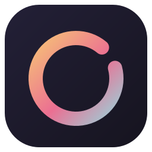
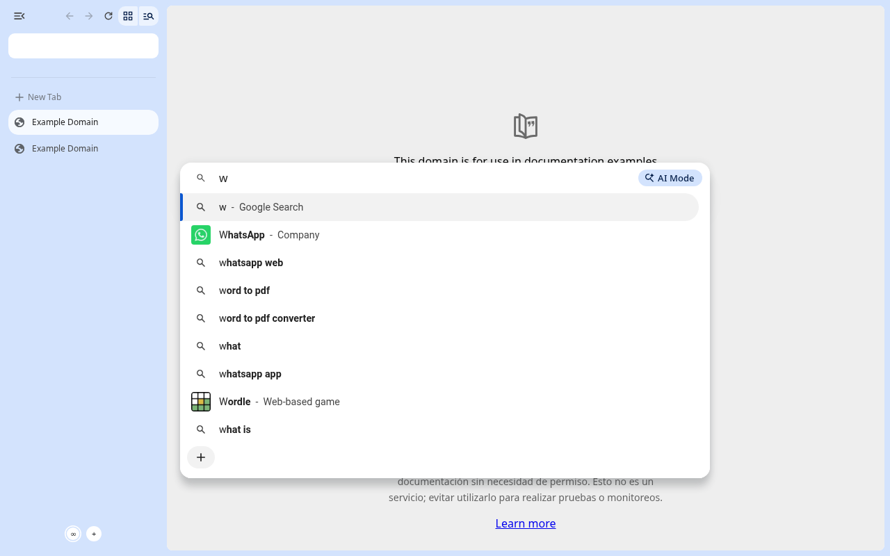
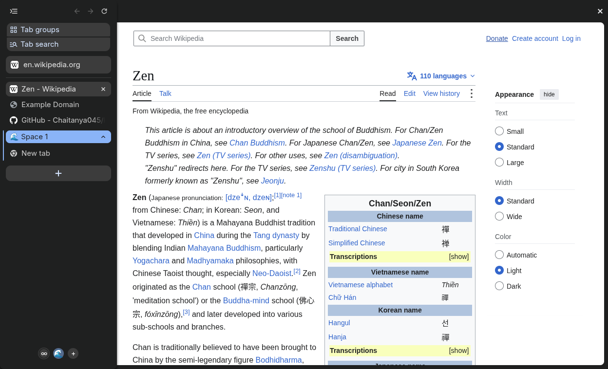
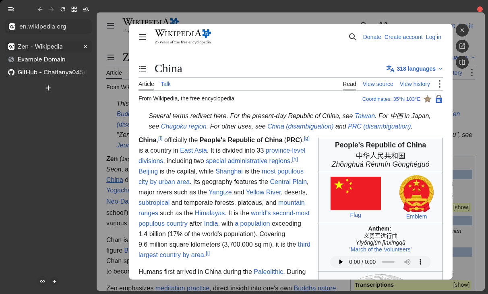

<div align="center">
  
  <h1>Koan</h1>
  <p>
    A calm, keyboard-first browser: Zen's way of working, on Chromium.
  </p>

[](https://github.com/Chaitanya045/koan/actions/workflows/ci.yml)
[](LICENSE)
[](CHROMIUM_VERSION)
[](#supported-platforms)

[Usage](docs/USAGE.md) •
[Koan vs Zen](docs/ZEN_PARITY.md) •
[Building](#building-from-source) •
[Contributing](CONTRIBUTING.md) •
[Issues](https://github.com/Chaitanya045/koan/issues)

</div>

Koan puts your tabs in a sidebar, shows the page as a floating card, and gets
out of the way until you need it. It brings the [Zen browser](https://zen-browser.app)'s
layout, workflow and keyboard shortcuts to Chromium. The browser UI is
native C++ (Chromium Views, compositor-driven animations), and the engine is
unmodified Chromium. Pages, extensions, DevTools and the web platform behave
exactly as they do in Chrome.

> [!NOTE]
> Koan is in early development and hasn't had its first release yet.
> It runs on Linux and is built from source for now. Expect rough edges,
> and please [report them](https://github.com/Chaitanya045/koan/issues/new/choose).

| Single-toolbar layout | Floating URL bar (<kbd>Ctrl</kbd>+<kbd>T</kbd>, or type after <kbd>Ctrl</kbd>+<kbd>L</kbd>) |
|---|---|
|  |  |
| **Compact mode (<kbd>Ctrl</kbd>+<kbd>S</kbd>), sidebar peeked** | **Glance (<kbd>Alt</kbd>+click a link)** |
|  |  |

## Features

- **Sidebar tabs.** Vertical tabs in a sidebar that shares one surface with
  the toolbar, and the page as a rounded card.
- **Single-toolbar layout.** Back, forward and reload live in the sidebar
  with a URL pill. The address bar floats over the page while you edit it.
  The multiple-toolbars layout is one shortcut away.
- **Compact mode.** Hide the sidebar and toolbar, and reveal them from the
  window edge.
- **Workspaces.** Group tabs into workspaces with an icon and a colour, and
  switch between them from the keyboard.
- **Glance.** Preview a link in a card over the page, then keep it or
  close it.
- **Split view.** Two pages side by side or stacked.
- **Zen's keyboard shortcuts.** See the [full list](docs/USAGE.md#shortcuts).
- **Zen's details.** Thin overlay scrollbars, and window buttons that
  appear when the pointer reaches the top edge.
- **Chromium underneath.** Chrome's rendering, extensions, DevTools and
  updates to the web platform. Every Koan feature can be switched off in
  `chrome://flags`.

[docs/ZEN_PARITY.md](docs/ZEN_PARITY.md) tracks every Zen feature: what
Koan matches, what differs and why, and what's still missing. Work in
progress is tracked in the
[issues](https://github.com/Chaitanya045/koan/issues).

## Downloads

There are no release builds yet. The first release (v0.1.0) will be
published on the [Releases](https://github.com/Chaitanya045/koan/releases)
page. Until then, [build Koan from source](#building-from-source).

### Supported platforms

| Platform | Status |
|---|---|
| Linux x86-64 (X11 and Wayland) | Supported |
| macOS (Apple Silicon) | In progress: built from source, see [#51](https://github.com/Chaitanya045/koan/issues/51) |
| Windows | Not yet |

## Building from source

Koan builds like Chromium, so you need a machine that can build Chromium:
Linux x86-64, 16 GB of RAM, 100 GB or more of free disk space, and a lot of
patience. The first build takes 10–15 hours on an 8-core machine. After
that, changes to Koan's own code rebuild in minutes.

```sh
git clone https://github.com/Chaitanya045/koan.git && cd koan
./scripts/bootstrap.sh            # depot_tools and the pinned Chromium checkout (long)
./scripts/apply_patches.sh        # link //koan and apply Koan's hook patches
./scripts/apply_branding.sh       # Koan's name and logos
./scripts/build.sh                # development build: chromium/src/out/Koan/chrome
./scripts/install_desktop.sh      # optional: add Koan to the app menu
```

For an optimised build, use `KOAN_CONFIG=release ./scripts/build.sh`, which
produces `out/Release/chrome`. `JOBS=<n>` limits parallel compile jobs on
machines with less memory.

On a Mac with Apple Silicon and Xcode, the same scripts build
`chromium/src/out/Koan/Koan.app`; see
[CONTRIBUTING.md](CONTRIBUTING.md#macos) for what you need.

The Chromium version Koan is pinned to is in
[`CHROMIUM_VERSION`](CHROMIUM_VERSION). Moving to a new version is described
in [docs/REBASE.md](docs/REBASE.md).

## How it works

Koan is a small layer on top of an unmodified Chromium checkout:

- **`src/`** holds all of Koan's code, built as GN `//koan`: features,
  prefs, and the views and controllers behind the sidebar, compact mode,
  workspaces and Glance.
- **`patches/`** holds hook patches for Chromium, one per upstream file and
  usually a few lines each, that call into `//koan`. Keeping them small
  makes moving to a new Chromium version cheap.
- **Branding** (name and logos) is applied by a script rather than by patches.
- **Feature flags:** every Koan feature is a `base::Feature` with a
  `chrome://flags` entry, built on upstream pieces where they exist (vertical
  tabs, tab groups, split view).

```
koan/
├── src/            Koan's C++ code (GN //koan)
├── patches/        hook patches for chromium/src, one per upstream file
├── branding/       logo sources (SVG) and the macOS app icon
├── build/          GN arguments for development, release and macOS builds
├── scripts/        bootstrap, build, patches, branding, tests
├── docs/           user and maintainer documentation
└── .agent/notes/   design notes, research and review records
```

## Documentation

| Document | What's in it |
|---|---|
| [docs/USAGE.md](docs/USAGE.md) | Features, layouts and keyboard shortcuts |
| [docs/ZEN_PARITY.md](docs/ZEN_PARITY.md) | Feature-by-feature comparison with Zen |
| [docs/PERFORMANCE.md](docs/PERFORMANCE.md) | Memory and power defaults, tab freezing, and measurements of Koan's UI |
| [docs/REBASE.md](docs/REBASE.md) | Updating Koan to a new Chromium version |
| [CONTRIBUTING.md](CONTRIBUTING.md) | Development setup, conventions and pull requests |
| [.agent/notes/](.agent/notes/README.md) | Design notes, research, decisions and review records |

## Contributing

Bug reports, ideas and pull requests are welcome. Please read
[CONTRIBUTING.md](CONTRIBUTING.md) before you start, and follow the
[Code of Conduct](CODE_OF_CONDUCT.md). To report a security vulnerability,
follow [SECURITY.md](SECURITY.md) and don't open a public issue.

## Credits

- **[Chromium](https://www.chromium.org/Home/)**, the open-source project
  behind Chrome, provides the engine and most of the browser.
- **[Zen](https://github.com/zen-browser/desktop)** is the Firefox-based
  browser whose design and workflow Koan follows. Koan re-implements that
  behaviour in C++ and contains no Zen code.

Koan is an independent project. It isn't affiliated with Google, the
Chromium project or the Zen browser project.

## License

Koan's own code is licensed under the [MIT License](LICENSE). Koan is built
on Chromium, whose code, including the upstream files changed by
`patches/`, remains under Chromium's BSD-style license. Files that port Zen
Browser's code, strings or styles are under Zen's MPL-2.0, as their headers
say. See [THIRD_PARTY_NOTICES.md](THIRD_PARTY_NOTICES.md).
