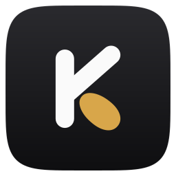
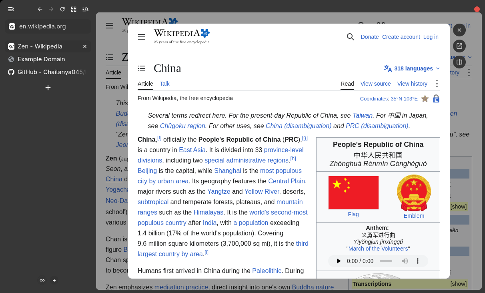

<div align="center">
  
  <h1>Koan</h1>
  <p>
    A calm, keyboard-first browser for macOS, with agents that work in tabs of their own.
  </p>

[](https://github.com/Chaitanya045/koan/releases/latest)
[](https://github.com/Chaitanya045/koan/actions/workflows/ci.yml)
[-black.svg?logo=apple&logoColor=white)](#download)
[](CHROMIUM_VERSION)
[](#license)

[Download](https://github.com/Chaitanya045/koan/releases/latest) •
[Usage](docs/USAGE.md) •
[Building](#building-from-source) •
[Contributing](CONTRIBUTING.md) •
[Issues](https://github.com/Chaitanya045/koan/issues)

</div>

Koan puts your tabs in a sidebar, shows the page as a floating card, and gets
out of the way until you need it. Everything is a keystroke away. Its UI is
native C++ on Chromium, so pages, extensions and DevTools work as they do in
Chrome.

Koan also lets AI agents (Claude Code, Cursor and others) use your browser
the way you do: in tabs of their own, signed in as you, without taking over
your screen or seeing your secrets.

<!-- Screenshot (pending, macOS official build): the window with sidebar tabs and Spaces.

-->

> [!WARNING]
> **Koan is in alpha.** It's for early testers: expect rough edges, and back
> up anything you can't lose. Settings and profile formats may change between
> alphas, Chromium security fixes are applied on a best-effort basis, and
> there's no automatic updater yet.

## Download

**[Download the latest release](https://github.com/Chaitanya045/koan/releases/latest)**
(`Koan-<version>-arm64.dmg`).

Requires **macOS on Apple Silicon** (M1 and later). Intel Macs aren't supported.

1. Open the DMG and drag **Koan** to **Applications**.
2. Koan isn't signed with an Apple Developer ID yet, so macOS blocks it the
   first time: *"Apple could not verify 'Koan' is free of malware"*. Allow
   it once, either way:
   - **Terminal:** `xattr -dr com.apple.quarantine /Applications/Koan.app`
   - **Or:** click **Done**, open **System Settings → Privacy & Security**,
     and click **Open Anyway** next to the message about Koan.
3. On first launch, macOS asks for your login password so that Koan can
   create its **"Koan Safe Storage"** key in your keychain, which encrypts
   saved passwords and cookies. Click **Always Allow**. Until Koan is signed
   with a Developer ID, expect this prompt once after each update.

To update, download the new release and drag it over the old one. Each
release's notes list its known issues. More detail:
[Installing the macOS build](docs/USAGE.md#installing-the-macos-build).

## Features

### Browsing

- **Sidebar tabs and Spaces.** Vertical tabs, pinned tabs, Essentials and
  folders. Each Space has its own icon and colour; switch with ⌘⌥← / ⌘⌥→,
  ⌃1…⌃0 or a two-finger swipe.
- **Single toolbar.** Back, forward and reload live in the sidebar. The
  address bar floats over the page while you type, and also runs commands.
- **Compact mode.** Hide the sidebar and toolbar; they slide back in from
  the window edge.
- **Glance.** Preview a link in a card over the page (⌥-click), then keep it
  or close it.
- **Split view.** Two pages side by side or stacked.
- **Library.** History, downloads and recently closed tabs in one place.
- **A clean look** in light and dark, built on shadcn/ui's design system,
  with a translucent glass style as an option. Onboarding imports your data
  from your current browser.
- **Chromium 158 underneath.** Chrome's rendering, extensions and DevTools.
  Every Koan feature can be switched off in `chrome://flags`.

<!-- Screenshots (pending, macOS official build):
| Floating URL bar (⌘T) | Compact mode (⌘S), sidebar peeking |
|---|---|
|  |  |
| **Glance (⌥-click a link)** | **Split view (⌘⌥V)** |
|  |  |
-->

### Agents in your browser

- **Set Up Agents** (Settings → Agent Control) installs Koan's guide into the
  coding agents on your Mac. Agents drive Koan with the `koan` command,
  which ships inside the app. You approve each agent once.
- **Agents work in their own Space.** Their tabs keep running in the
  background while you use the rest of Koan. A pill on the tab an agent
  controls, and a chip in the sidebar, show what it's doing.
- **Take over at any time.** Click into an agent's tab and it pauses. Leave
  the tab for about 5 seconds and it carries on where you left off, knowing
  what you changed.
- **Your logins and autofill, without your secrets.** Agents can sign in
  with your saved logins and fill saved addresses and cards through
  Chrome's own autofill. They see the labels, never the values: passwords
  and card numbers stay hidden, even in screenshots.
- **You stay in charge.** Agents hand the tab to you for passwords you
  haven't saved, two-factor codes, CAPTCHAs and the final Pay button.
- **Cheap for agents.** Compact page outlines, small screenshots (a mini
  one costs about 5% of a full screenshot's tokens), and many actions in
  one call.

<!-- Screenshot (pending, macOS official build): an agent working in its own Space, with the indicator.

-->

A session, as an agent runs it:

```sh
koan pair --label "Claude Code"        # once: you approve the agent in Koan
koan open https://example.com/signup   # a background tab in the agent's Space; prints its id
koan snapshot a1b2 --interactive       # what's on the page, as a short outline with @refs
koan act a1b2 fill @12 "Ada" fill @13 "Lovelace" autofill @20 1 click @31 --snapshot
koan screenshot a1b2 --size mini       # a small screenshot, about 330 image tokens
koan end                               # closes the agent's tabs
```

Details, settings and every command:
[Agent control](docs/USAGE.md#agent-control).

## Shortcuts

| Action | Keys |
|---|---|
| New tab (opens the floating URL bar) | ⌘T |
| Edit the address | ⌘L |
| Toggle compact mode | ⌘S |
| Show the sidebar in compact mode | ⌘⌥S |
| Next / previous Space | ⌘⌥→ / ⌘⌥← |
| Space 1 to 10 | ⌃1 … ⌃0 |
| Glance a link; open the Glance as a tab | ⌥-click; ⌘O |
| Split side by side / stacked; unsplit | ⌘⌥V / ⌘⌥H; ⌘⌥U |
| Pin / unpin tab | ⌘⇧D |
| Close all unpinned tabs | ⌘⇧K |
| Copy the page's URL (as Markdown) | ⌘⇧C (⌘⇧⌥C) |
| Library; History; Downloads | ⌥⇧L; ⌘Y; ⌘J |
| New private window | ⌘⇧P |
| Settings | ⌘, |

Every shortcut can be changed in Settings → Keyboard Shortcuts. The full
list, with what each key did in Chrome:
[docs/USAGE.md](docs/USAGE.md#shortcuts).

## Releases

- **Alpha** (`vX.Y.Z-alpha.N`): tested builds, for early testers. Start here.
- **Nightly**: built every night from `develop`, replaced each time. For
  trying the newest changes.

Versions follow SemVer and name the Chromium version they're built on, for
example **Koan 0.0.1 (Alpha) · Chromium 158.0.8127.18**. While Koan is in
alpha, settings and profile formats may change between versions, Chromium's
security fixes are applied on a best-effort basis rather than on Chrome's
schedule, and there's no automatic updater. How releases are made:
[docs/RELEASING.md](docs/RELEASING.md).

## Building from source

Koan builds like Chromium, so it needs an Apple Silicon Mac with the full
Xcode, about 100 GB of free disk and a lot of patience: the first build
takes many hours. One command fetches, builds and installs Koan in
`~/Applications`, and the same command updates it:

```sh
git clone https://github.com/Chaitanya045/koan.git && cd koan
scripts/build.sh
```

See [docs/BUILDING-MAC.md](docs/BUILDING-MAC.md) for the requirements and
details. Development and the off-screen end-to-end tests also run on Linux;
see [CONTRIBUTING.md](CONTRIBUTING.md#development-setup).

### How it works

Koan is a small layer on top of an unmodified Chromium checkout, pinned to
the release in [`CHROMIUM_VERSION`](CHROMIUM_VERSION):

```
koan/
├── src/            Koan's C++ code (GN //koan): views, controllers, prefs, the koan CLI
├── patches/        small hook patches for chromium/src, one per upstream file
├── branding/       logo sources and the macOS app icon
├── build/          GN arguments for development, release and macOS builds
├── scripts/        bootstrap, build, patches, branding, tests
└── docs/           user and maintainer documentation
```

Each patch is a few lines that call into `//koan`, which keeps moving to a
new Chromium release cheap ([docs/REBASE.md](docs/REBASE.md)).

## Documentation

| Document | What's in it |
|---|---|
| [docs/USAGE.md](docs/USAGE.md) | Every feature, setting and shortcut, and agent control |
| [docs/BUILDING-MAC.md](docs/BUILDING-MAC.md) | Building Koan on your Mac |
| [docs/RELEASING.md](docs/RELEASING.md) | Channels, versions and how releases are made |
| [docs/PERFORMANCE.md](docs/PERFORMANCE.md) | Memory and power defaults, tab freezing |
| [docs/REBASE.md](docs/REBASE.md) | Updating Koan to a new Chromium version |
| [CONTRIBUTING.md](CONTRIBUTING.md) | Development setup, conventions and pull requests |

## Contributing

Bug reports, ideas and pull requests are welcome. Please read
[CONTRIBUTING.md](CONTRIBUTING.md) before you start, and follow the
[Code of Conduct](CODE_OF_CONDUCT.md).

## Security

To report a vulnerability, follow [SECURITY.md](SECURITY.md) and don't open
a public issue. It also says which versions are supported and what agents
can and can't reach.

## License

Koan's own code is under the [MIT License](LICENSE). Some files are under
the MPL-2.0, as their headers say. Koan is built on
[Chromium](https://www.chromium.org/Home/), whose code, including the
upstream files changed by `patches/`, remains under Chromium's BSD-style
license. See [THIRD_PARTY_NOTICES.md](THIRD_PARTY_NOTICES.md).

Koan is an independent project and isn't affiliated with Google or the
Chromium project.
