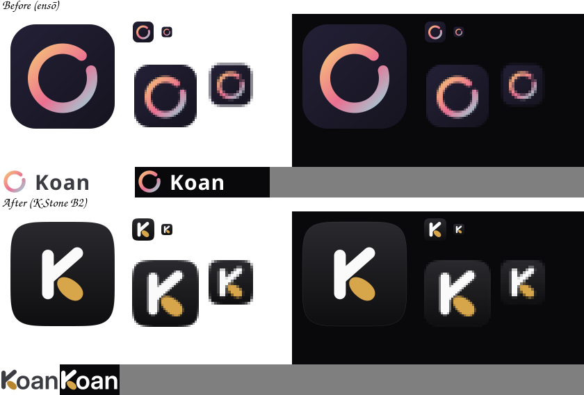
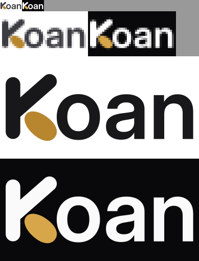

# Branding

Koan's name and logos reach Chromium through `scripts/apply_branding.sh`
(`scripts/branding.py`), not through patches. CONTRIBUTING.md explains the
render and Mac steps. This page covers the logo itself.

## Logo

**The idea.** The K-Stone mark is a K whose leg is a stone: a rounded stem,
a round-capped arm, and an ochre pebble lying on the leg's diagonal, from
the junction to the arm's right edge, so the arm tip and the pebble end
level. It is a letter and a stone in a zen garden at once. The pebble is
part of the letter, never a dot after it.

**Colours.**

| | Stem and arm | Stone | Body (app icon) |
|---|---|---|---|
| On light | zinc 900 `#18181b` | ochre `#b7862f` | `#ffffff` to `#e9e9ec` |
| On dark | zinc 50 `#fafafa` | dark ochre `#d8a64a` | `#2a2a2e` to `#0e0e10` |
| Tinted (macOS 26) | white | white at 70 % | `#2a2a2e` to `#121214` |

The bitmap icons (pre-26 macOS, Finder, the DMG, WebUI, the README) use the
dark appearance, which matches Koan's dark default.

**Clear space and minimum size.** Keep clear space around the mark of at
least the stem's width (17 of the 100-unit box) on every side. The mark sits
at 66 % of the icon body. At 16 and 32 px Chromium's product logos use
`branding/logo_small.svg`: the same mark, larger, on a full-bleed body. A
transparent flat mark disappears on dark surfaces (Settings > About, task
manager, infobars all use one bitmap in light and dark), so the body stays.
Don't draw the mark below 16 px.

**Wordmark.** The mark is the K. The wordmark is the mark followed by "oan"
in Inter Display SemiBold, reading as one word, "Koan":

- The stem is the cap height and stands on the baseline; the pebble
  overshoots the baseline slightly, as drawn.
- The gap from the mark's right edge (where the arm tip and the pebble are
  level) to the "o" is Inter's own K–o gap in "Koan" (−2 of 2048 units, so
  they nearly touch).
- Stem, arm and text take the text colour; the pebble stays ochre (the dark
  ochre on dark).

**Don'ts.**

- Never set "Koan" after the mark: the mark is the K. "K Koan" is wrong.
- Don't recolour the stone (only the tinted appearance turns it white).
- Don't separate the stone from the K, move it, or resize it on its own.
- Don't add a dot or full stop after the K.
- Don't add effects to the mark (gradients, outlines, shadows) outside the
  app icon body.

**Font.** The wordmark is Inter Display SemiBold 4.1, outlined to paths, so
no font ships with the app. Inter is under the SIL Open Font License 1.1,
which allows this and needs no attribution in the product.

### Files

| File | What |
|---|---|
| `branding/logo.svg` | Full-colour icon, 256 box, body at (8, 8) 240 × 240 (`LOGO_BODY`). Also WebUI's dark logo and the macOS bitmaps on Apple's grid. |
| `branding/logo_small.svg` | 16/32 px product logos (`logo_small_*.png`). |
| `branding/logo_mono.svg` | 22 px single-colour template (`mark_path(22)`). |
| `branding/wordmark.svg` | 43 × 22 lockup (`WORDMARK_SIZE`), `COLOR` and `STONE` placeholders. |
| `branding/mac/AppIcon.icon/` | Icon Composer document for macOS 26+: `ink` (stem and arm) and `stone` layers, light, dark and tinted fills. |
| `scripts/branding.py` | The mark's geometry (`MARK_*`, `pebble_points()`) and `mark_path()`, the one-path mark for Settings' `cr:chrome-product` icon. |

The art comes from the K-Stone round 2 work in `~/work/koan-logo/kstone/`
on the maintainer's machine (variant B2; `build_final.py`, `final/`), which
is not in the repo. The repo's SVGs were cut from that geometry, which now
lives in `branding.py`. After changing any `branding/*.svg`, run
`scripts/apply_branding.sh --render-mac` on Linux and commit
`branding/mac/rendered/`. `app.icns` and `Assets.car` are built on the Mac
(`branding.py mac-assets`).
