# Using Koan

Koan is Chromium with Zen's way of working: tabs in a sidebar, the page as a
floating card, workspaces, Glance and compact mode. Everything web-facing is
plain Chromium (rendering, DevTools, extensions, `chrome://` pages).

## Shortcuts

Koan uses Zen's default shortcuts (Zen shortcuts version 21, Linux). Where
Zen deliberately rebinds a key that Chrome uses, Koan follows Zen; the
"Chrome had" column says what moved. Everything not listed behaves as in
Chrome.

| Action | Keys | Chrome had |
|---|---|---|
| Toggle compact mode | Ctrl+S | Save page (now Ctrl+Alt+Shift+S) |
| Show the sidebar in compact mode | Ctrl+Alt+S (⌘⌥S) | |
| Next / previous Space | Ctrl+Alt+Right / Ctrl+Alt+Left (⌘⌥→ / ⌘⌥←) | macOS: next / previous tab (still Ctrl+Tab) |
| Space 1 to 10 | macOS: Ctrl+1 … Ctrl+9, Ctrl+0 (no keys elsewhere, as in Zen; set them in Settings) | |
| Split view: side by side | Ctrl+Alt+V (⌘⌥V) | |
| Split view: stacked | Ctrl+Alt+H (⌘⌥H) | macOS: Hide Others |
| Split view: grid (two panes in Chromium: side by side) | Ctrl+Alt+G (⌘⌥G) | |
| Unsplit | Ctrl+Alt+U (⌘⌥U) | macOS: View Source (still in the View menu) |
| New split with an empty tab | Ctrl+Shift+* (⌘⇧*) | |
| New tab (opens the URL bar; the tab opens with what you pick) | Ctrl+T (⌘T) | New-tab page |
| Copy the page's URL | Ctrl+Shift+C (⌘⇧C) | Inspect element (now Ctrl+Shift+L) |
| Copy the page's URL as Markdown | Ctrl+Shift+Alt+C | |
| Pin / unpin tab (pinned to its Space) | Ctrl+Shift+D | Bookmark all tabs |
| Close tab; a pinned tab or Essential instead goes back to its pinned URL, unloads and switches away | Ctrl+W, Ctrl+F4 (⌘W) | |
| Close all unpinned tabs (in the Space; keeps the selected one; Ctrl+Shift+T reopens the last closed tab, one per press) | Ctrl+Shift+K | |
| Expand Glance to a tab | Ctrl+O (⌘O) while Glance is open | Open file (still, otherwise) |
| Glance a link | Alt+click (⌥+click; trigger method in Koan's settings) | (Alt+click downloaded the link) |
| Close Glance | Esc (twice while typing in the page), or click the dimmed page | |
| Save page | Ctrl+Alt+Shift+S | |
| Open / close the Library | Alt+Shift+L (⌥⇧L) | |
| Library: History | Ctrl+H or Ctrl+Shift+H (⌘⇧H or ⌘Y) | History page (Ctrl+H; macOS ⌘Y) |
| Inspect element | Ctrl+Shift+L | |
| New window | Ctrl+Shift+N | New incognito window |
| New private window | Ctrl+Shift+P | Print using system dialog |
| Mute site | Ctrl+M | |
| Bookmarks | Ctrl+B | |
| Library: Downloads | Ctrl+Shift+Y (⌘⇧J) | macOS: Downloads page (⌘⇧J) |
| Reading mode | Ctrl+Alt+R | |
| Edit the address | Ctrl+L, or click the URL pill | |
| **Koan only:** switch single / multiple toolbars | Ctrl+Alt+B | |
| **Koan only:** create a Space | Ctrl+Alt+N | |
| Koan settings (Zen's "Open Preferences") | Ctrl+, | |

Change any of them in Settings > Keyboard Shortcuts (below).

When a page uses a key itself (for example Ctrl+S in an online editor), the
page gets it first, as in every browser.

## Layout

Koan starts in Zen's default layout, **single toolbar**: there is no toolbar
across the top, and the page reaches the top of the window. The top row of
the sidebar has the sidebar toggle, back / forward / reload and the tab
groups / tab search buttons; below it is a pill with the current site.

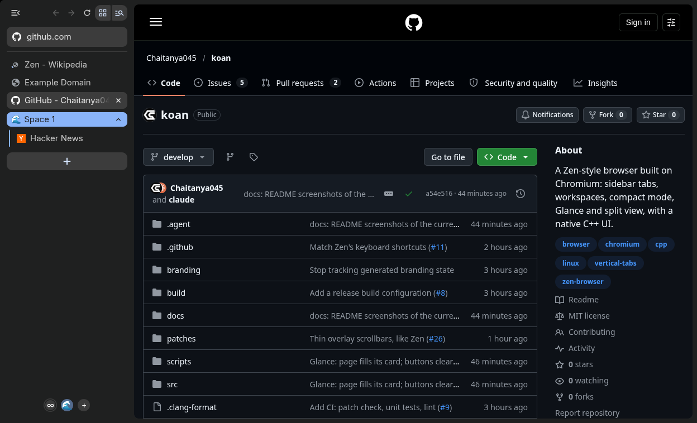

Click the pill or press Ctrl+L to edit the address (see [URL bar](#url-bar)).

As in Zen, nothing sits above the page but a thin margin: move the pointer
to the top edge of the window to show the window buttons (close, ...); the
page moves down to make room and back up when you leave. When the buttons
are on the sidebar's side of the window (e.g. GNOME's buttons with tabs on
the right, or a "close,minimize,maximize:" button layout with tabs on the
left), they stay in the sidebar's top row instead, as in Zen.

Ctrl+Alt+B switches to the multiple-toolbars layout (a toolbar above the
page, as in Chrome) and back. The layout applies to all windows and
persists.

**Collapsed sidebar**: the sidebar toggle (left end of its top row)
collapses the sidebar to icons, Zen's "Collapsed Sidebar" layout: the
toolbar sits above the page, and the sidebar expands over the page while
the pointer is on it (right-click the toggle to turn that off). Like Zen,
single toolbar needs the full sidebar: the toggle or Ctrl+Alt+B expands it
into single toolbar again.

**Tabs on the right**: right-click an empty part of the sidebar and pick
**Tabs on the right** (or Settings > Look and Feel > Vertical Tabs).
Everything mirrors: the sidebar is on the right, its top row and resize
edge too, and compact mode reveals it at the right edge. (In a
right-to-left UI, where the sidebar is normally on the right, it goes to
the left.)

On macOS the window buttons (traffic lights) stay at the top left: Koan
can't hide them yet, so with the sidebar hidden or on the right they sit
over the page's corner.

## URL bar

Like Zen's, the URL bar opens where you are and floats once you type:
clicking the pill (or Ctrl+L) edits the address right in the pill; the
first keystroke lifts it into a card centred over the window (two thirds
of its width, at most 750 px, larger text, a soft shadow over the page)
with the suggestions under it. The pill is empty meanwhile. Esc, a click
outside the card or opening a result (or running an action) closes it;
switching to another window and back leaves it as it was. In compact mode,
with the sidebar hidden, it floats right away, also when you click the pill
of the peeked sidebar.

| Editing in the pill | Floating once you type | Ctrl+T |
|---|---|---|
| 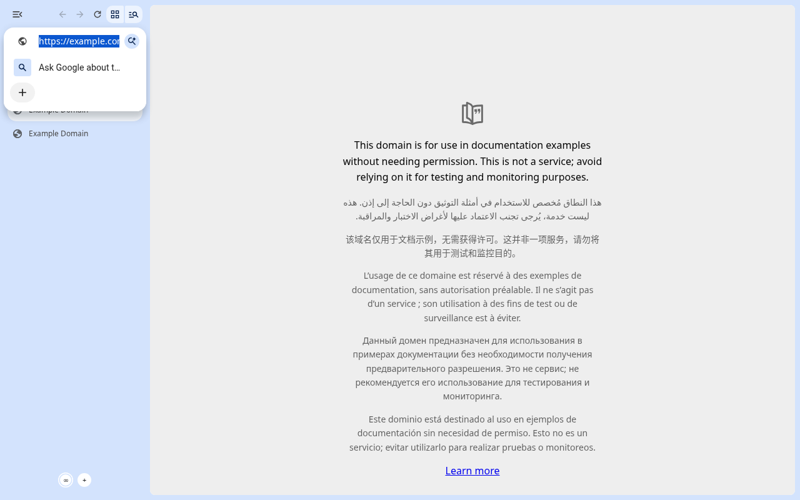 | 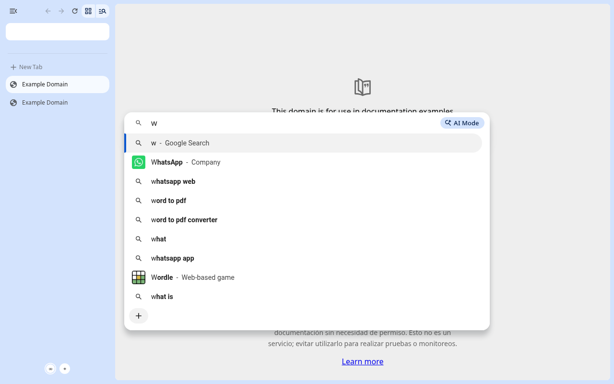 | 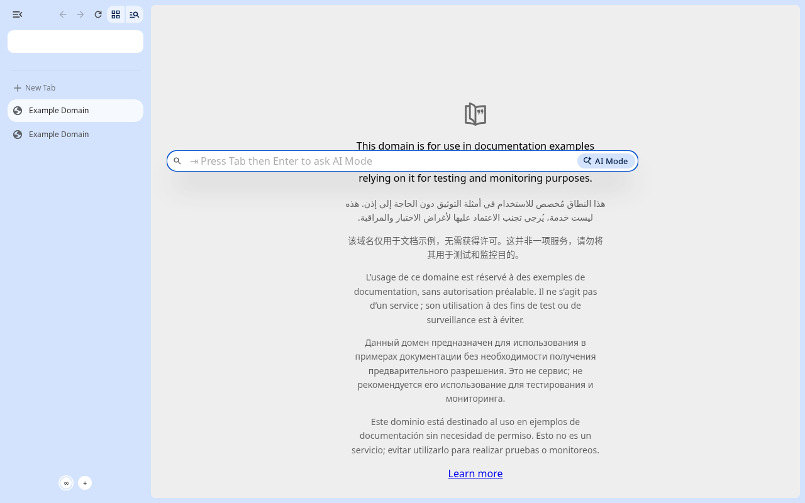 |

**Ctrl+T** (⌘T; also the sidebar's **+ New Tab** and the menus' New Tab)
opens the URL bar, empty, instead of a new-tab page: the tab opens only
when you open something from it, in a new tab next to the current one.
(With Chromium's horizontal tabs, the tab strip's **+** still opens a
new-tab page.) Esc, a click outside or Ctrl+T again closes it without
creating anything; what you had typed comes back if you press Ctrl+T again
within 45 seconds.

Hover the pill (or Tab to it) for the **copy** button: it copies the page's
URL and says so ("Copied current URL!"), as do Ctrl+Shift+C and
Ctrl+Shift+Alt+C (Markdown link; ⌘⇧C and ⌘⇧⌥C on macOS). The button at the end of the pill
opens the site's panel (security, permissions, cookies and site settings).

| "Normal": editing in place, widened | Copied |
|---|---|
| 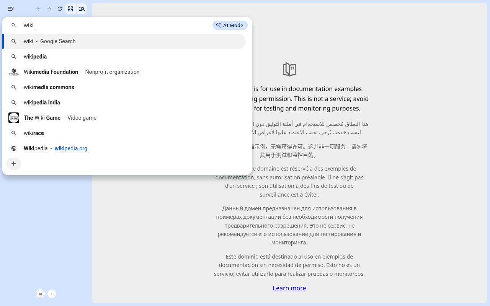 | 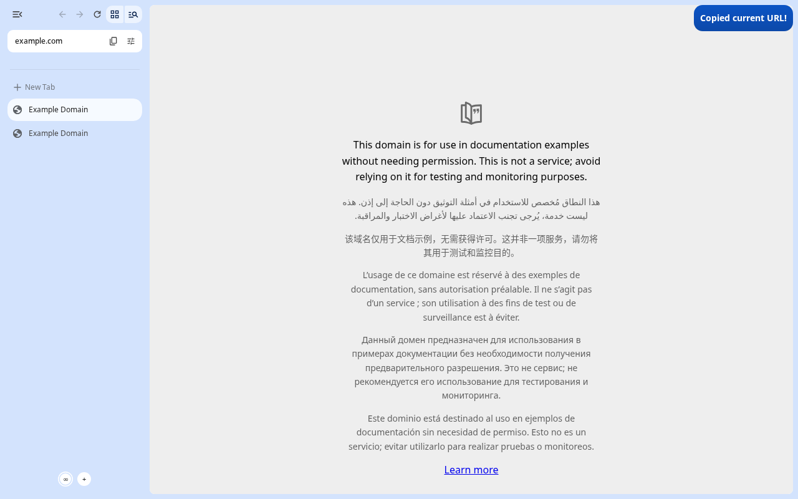 |

Settings, in Koan's settings (Ctrl+,) under Look and Feel > URL Bar
(profile prefs, Zen's names in brackets):

| Setting | Pref | Default |
|---|---|---|
| Behavior: **Normal** (always edit in the pill; it widens over the page while you type), **Floating only when typing** (as above), **Always floating** | `koan.urlbar.behavior` (`zen.urlbar.behavior`) | Floating only when typing |
| Open the URL bar instead of a new tab page | `koan.urlbar.replace_newtab` (`zen.urlbar.replace-newtab`) | on |
| Show the copy URL button | `koan.urlbar.show_copy_url` (`zen.urlbar.single-toolbar-show-copy-url`) | on |

In the multiple-toolbars layout the address is edited in the toolbar, as
in Chrome; Ctrl+T still opens it instead of a new-tab page, and Esc closes
it in one press.

## Command palette

As in Zen, the URL bar runs actions too. Type three or more letters of an
action ("compact", "pin tab", "dark") and up to three matching actions
appear right below the first suggestion, with their shortcut; pick one with
the arrow keys and Enter, or click it. An action you have run comes first
the next time, and typing its whole name ("toggle compact mode") makes Enter
run it; actions you keep passing over drop below the search suggestions.
Typing the start of an address still opens the site.

To see every action, press Tab in an empty URL bar (Ctrl+L, Backspace,
Tab) or type `>`; Tab again leaves. Typing filters the list, and once you
have typed two letters Enter runs the first match.

The actions, with Zen's names: Toggle Compact Mode, New Split View, Expand
current view (unsplit), Copy Current URL, Settings, Open Private Window,
Open New Window, Pin / Unpin Tab, Add to / Remove from Essentials, Close
Tab, Reopen Closed Tab, Duplicate Current Tab, Reload Tab, Reload Tab
Without Cache, Next / Previous Tab, Capture Screenshot, Find in Page, Manage
Extensions, Switch to Automatic Appearance / Light Mode / Dark Mode, Print;
with workspaces also New Space, Next / Previous Space and "Focus on" each
other Space (type its name). Only the actions that apply are offered (Unpin
Tab on a pinned tab, Next Space with two Spaces, ...).

## Sidebar

Vertical tabs are on by default, laid out like Zen's. The
**Essentials** are square tiles at the top, up to four across, shared by
every Space. Below them is the Space header (the active Space's icon and
name), then a thin line, **+ New Tab** (opens a tab at the top of the
Space's tabs) and the tabs. A tab's close button shows while you point at
it.

While the pointer is over the sidebar, **↓ Clear** appears at the end of
the line: it closes the Space's unpinned tabs except the selected one and
any playing sound (if those are all there is, it closes them too), the
same as Ctrl+Shift+K. The Space stays (an emptied one gets a fresh tab),
and a toast reminds you that Ctrl+Shift+T reopens them, the last closed
tab first, one per press.

Drag the sidebar's edge to resize it (163 to 500 px, as in Zen). At the
bottom is Zen's bottom bar: one button per Space (its emoji, or a dot; the
active one in colour, the others grey) and **+**, which opens the Create
menu: Create Space, New Split and New Tab.
The Space buttons only show once there is more than one Space.

Right-clicking an empty part of the sidebar opens Zen's toolbar menu:
**Compact Mode** (below) and **Tabs on the right**. Dragging the sidebar's
edge resizes it; dragging it closed hides it in compact mode, as in Zen
("Sidebar hidden! Use Ctrl+S to bring the sidebar back", shown once). If
compact mode was set to hide just the toolbar, the drag makes it hide both.

## Pinned tabs and Essentials

As in Zen there are two kinds of pinned tab:

- **Pinned tabs** belong to their Space and stay at the top of its
  tabs. Pin a tab with Ctrl+Shift+D or "Pin" in its context menu.
- **Essentials** are shared by all Spaces, up to 12 per window: "Add to
  Essentials" in the tab's context menu shows how many are used ("3 / 12").
  Dragging a tab into the grid also makes it an Essential.

Both remember the URL they were pinned on, the **pinned URL**. When a pinned
tab goes elsewhere, a slash appears after its icon: hover it to see the
pinned page's icon and "Back to pinned url", click to go back (Ctrl+click
first moves the current page to a new tab). The context menu also has
"Reset Pinned Tab", "Replace with Current URL" and "Edit Pinned URL…"
("…Essential…" for Essentials).

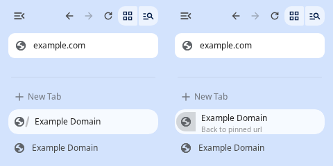

Closing a pinned tab or an Essential (Ctrl+W, its close button, a middle
click) doesn't close it: like Zen, it goes back to its pinned URL, is
unloaded to free memory and the next tab is selected. A pinned tab that is
already unloaded closes from its close button. Settings > Tab Management >
Pinned Tabs has Zen's choices for what closing does, and "Restore pinned
tabs to their originally pinned URL on startup" (off by default, as in
Zen). Pinned tabs, like Essentials, are never frozen in the background,
and Close Other Tabs, Close Tabs Below and Back in a tab with no history
leave them open. Drag a pinned tab below the other tabs to unpin it, or a
tab among the pinned ones to pin it. With several pinned tabs selected,
Ctrl+W does the same to each of them and closes none of the others.

Any tab's context menu has "Change Label…" (edit the name in place; Enter
keeps it, Esc cancels, an empty name goes back to the page title), "Change
Icon…" (an emoji instead of the favicon) and "Unload" (free the tab's
memory; it reloads when you select it). Pinned URLs, labels and icons are
kept with the session.

## Spaces

A Space is a set of tabs shown on its own, like Zen's Spaces. The window
always shows one: a new window starts in a Space named "Space", every tab
belongs to a Space, and new tabs open in the active one.

- **Create** a Space with **+ > Create Space** (or Ctrl+Alt+N): the sidebar
  shows Zen's Create-a-Space form (a collapsed sidebar expands over the
  page until you're done). Click the dashed box to pick an emoji
  (search by keyword), type a name, Edit Theme… to pick its colour, then
  Create Space (or Enter); Escape or Cancel goes back.
- **Rename**: double-click the Space's name in the header (or right-click
  the header > Change Name…) and type; Enter keeps it, Escape cancels.
  Double-click the icon (or Change Icon…) to pick another emoji, or none.
- From the keyboard, the header takes focus (Tab through the sidebar):
  Enter or the menu key opens its menu, F2 renames the Space.
- **Edit Theme…** (right-click the header) picks the Space's colour: the
  browser takes it while the Space is active, or keeps your theme with
  Default.
- **Switch**: click a Space in the bottom bar, Ctrl+Alt+Left/Right (⌘⌥
  on macOS; they wrap around), on macOS Ctrl+1…0 for Space 1 to 10, swipe
  horizontally with two fingers over the sidebar, or turn the mouse wheel
  there (horizontally, or vertically while holding Ctrl); the right-click
  menu of the header also lists the Spaces. The old Space slides out and
  the new one in, as in Zen, and you land on the tab you left the Space on
  (also after a restart). Going straight to a tab of another Space (the
  address bar's "Switch to this tab", tab search) shows that tab.
- **Move To**: right-click a tab > Move To moves it (and the other
  selected tabs) to another Space and shows it.
- **Unload Space** (right-click the header or a Space button) frees the
  Space's tabs; they reload when you select them. Unload All Other Spaces
  frees all the others. Tabs on screen and tabs in use (playing sound, in
  a call or sharing the screen, open in DevTools, with a half-filled form,
  and others Memory Saver keeps) stay loaded; a toast says how many.
- **Delete Space** (same menu) closes the Space's tabs after asking. The
  last Space can't be deleted.
- Closing a Space's last tab leaves the Space with a new tab, where Zen
  shows an empty Space.

Spaces and the active one are restored on restart (Koan restores the
previous session by default; change it in Settings > On startup).

## Compact mode

Ctrl+S hides the sidebar; the page fills the window with a thin margin.
Move the pointer to the left edge (or press Ctrl+Alt+S) to slide the
sidebar out, with its navigation buttons and URL pill. Ctrl+L and Ctrl+T
open the floating URL bar. The setting applies to all windows and persists.
The sidebar slides in over the page; the page doesn't move or reflow.

In the multiple-toolbars layout you choose what compact mode hides, in the
sidebar's menu under **Compact Mode**: **Hide sidebar** (the default, as in
Zen), **Hide toolbar** or **Hide both**. A hidden toolbar slides down when
the pointer reaches the top edge, with the window buttons. With the sidebar
collapsed to icons and the window buttons on its side, Zen doesn't offer
hiding just the toolbar, and neither does Koan: the menu item is off, and
if hiding just the toolbar is chosen (e.g. in Settings, or before the
sidebar was collapsed), that window hides the sidebar instead. The choice
itself is kept, for the other windows and for when the sidebar is expanded
again.

The same choices are in Settings (Ctrl+,) > Look and Feel > Show in
compact view, with Zen's "Briefly make the toolbar popup when switching or
opening new tabs in compact mode" (off by default): the hidden sidebar then
pops up for a moment whenever you switch tabs.

## Glance

Alt+click a link (or Alt+Enter on a focused link) to preview it in a card
over the page, as in Zen. The card grows out of the click and shrinks back
into it when it closes; the page behind fades into the window background.
**Open Link in Glance** in the link context menu does the same. An Alt+click
on a link in the Glance page shows that link in the card. Shift+click opens
a new window, as in Zen and Firefox. Same-site links with a `download`
attribute still download.

Beside the card: close (Esc, or a click on the faded page), **Expand
Glance** to a tab (Ctrl+O; ⌘O on macOS) and **Split Glance** with the
current tab. As in Zen, while you type in the Glance page the first Esc
only turns the close button red ("Press Esc again to close"); a second Esc
within 3 seconds closes. A page that asks before you leave it ("Leave
site?") gets to ask.

On macOS, as in Zen (whose default trigger is `alt` on every platform):
Alt is the Option key, so ⌥+click opens Glance, Meta is ⌘, and the split
view shortcuts are ⌘⌥V / ⌘⌥H / ⌘⌥G / ⌘⌥U, which take over View Source
(⌘⌥U) and Hide Others (⌘⌥H) from the keyboard. Ctrl+click is a right-click
on macOS, so it isn't offered as a trigger there. On macOS the card
appears and goes without growing and shrinking (not verified on a Mac
yet).

**Settings** (Koan's settings, Look and Feel → Glance; Zen's
`zen.glance.enabled` and `zen.glance.activation-method`): **Enable Glance**,
and **Trigger method**: Ctrl + Click, Alt + Click (the default), Shift +
Click or Meta (Command) + Click. The trigger method reaches pages opened
after the change (pages already open, and new ones that share their
renderer, keep the old method until Koan restarts). With another trigger
method, a click Glance can't open (not a web link, an app window) does
what that modifier does without Glance (Ctrl: a background tab; Shift: a
window). The "Koan Glance" flag in `chrome://flags` removes Glance
altogether.

## Split view

Besides the shortcuts above:

- Tab context menu: **Add Split View...** splits the tab with the current
  one (or with a new tab, for the current tab), **Join 2 Tabs** splits a
  two-tab selection, **Split Out Tab** separates a split (Zen's labels).
  Upstream's **Arrange split view** and **Move tab into split view** stay.
- Link context menu: **Split Link to New Tab** opens the link beside the
  page; in a split, "Open link in left/right view" loads it in the other
  view.
- Drag a tab onto the left or right edge of the page to split with it
  (Chromium's split view drop targets).
- Chromium's split views have two panes (Zen's take four, in a grid): a
  third panel (Split Glance over a split, a split shortcut with more tabs
  selected) shows Zen's "Can't add more panels to the split view!" toast.

## Look

Koan's default look is **Zen's**: its colours (Zen 1.24b's zen-theme.css:
window frame `#181717` / `#e5e5e5`, content `#101010` / `#fafbff`, dialogs, panels, text, borders,
the system accent colour), per-Space gradient themes and, on macOS, glass.
Everything Koan or Chromium draws (the frame, sidebar, tabs, Essentials,
Spaces bar, URL bar, menus, bubbles, dialogs, find bar, settings, the new tab
page) takes its colours from that token set, so Chromium's own surfaces
match Zen too. The Zen look follows the system's light or dark mode.

**shadcn/ui's design system** is a second look, dark and near-black
(Chromium's greys never show): the same surfaces take their colours from
shadcn's tokens (`background`, `foreground`, `card`, `popover`, `primary`,
`secondary`, `muted`, `accent`, `destructive`, `border`, `input`, `ring`, the
`sidebar-*` set) and their corner radii from `--radius` (10px: sm 6, md 8,
lg 10, xl 14). The font is Geist (bundled, SIL OFL), from the next start.

**Settings > Look and Feel > Appearance** (browser-wide, applies at once to
every window):

- **Look**: Zen (default) or shadcn/ui. Zen has its gradient themes and the
  theme picker's per-Space colours; the choices below are shadcn's.
- **Mode** (shadcn only; Zen follows the system): Dark (default), Light, or Automatic (follow the system). The
  mode is the window's colour mode, so on macOS the title bar, scrollbars and
  native menus follow it. Websites keep their own colour scheme
  (Chromium's Appearance setting), as in Zen. Private windows are always
  dark.
- **Base colour**: Black (default), Neutral, Zinc, Slate, Stone or Gray.
  Black is Koan's near-black Zinc: background and frame `#09090b`, cards and
  popovers `#18181b`, borders and hover surfaces `#27272a`. The others are
  shadcn's own (Neutral's dark background is `#0a0a0a`, its cards `#171717`).
- **Accent colour**: none (the base's own primary colour), Blue, Green,
  Orange, Red, Rose, Violet or Yellow.
- **Paste a theme**: the CSS that ui.shadcn.com/themes or tweakcn.com makes
  (`:root { --background: oklch(...); ... } .dark { ... }`, in oklch, hsl,
  rgb or hex, and `--radius`). Unknown variables are ignored and missing
  ones keep the base colour's; text without any token is refused. Remove
  it to go back to the base colour.

The colours are shadcn's own OKLCH values, converted to sRGB exactly, and
generated from its registry (`scripts/gen_shadcn_palettes.py`).

In both looks the floating URL bar (typing in the URL bar, or ⌘T / ⌘L) is a
command-dialog card with a magnifier, a "Search..." placeholder (muted, also
while focused), a thin divider under the field and "title — url" suggestions.

- **Zen look**: the card is two thirds of the window wide (at most 750 px),
  centred as Zen centres it, on a flat `#181818` (white in light mode) fill
  with a 0.5 px outline, radius 15 and Zen's long soft shadow. The input row
  is 62 pt high with 17 pt medium text and no focus ring; the divider is
  inset from the card's edges. Suggestion rows are 49 pt high, radius 8, in
  14 pt medium text, the selected row in the accent colour. These row
  styles apply only to this card: any other omnibox popup keeps Chromium's.
- **shadcn look**: the card is 55% of the window wide, a little above the
  middle, on `popover` (#18181b) with a 1px `border` outline, shadcn's soft
  shadow and a `rounded-xl` corner, in Geist. Suggestions below it are
  `popover` too, with `accent` for the selected row, and the url in
  `muted-foreground`. Not yet: the background blur and the card's 0.9 alpha.

Limits: menus macOS draws itself (page context menus, the menu bar) are
dark or light with the mode but not coloured by the tokens; the font is
loaded at start. The system's high-contrast setting is not
followed by the colours the look sets itself (the system and core colours);
only Chromium's own high-contrast paths still apply.

## Settings

`chrome://koan-settings` (or Ctrl+,) has Koan's settings, laid out like
Zen's preferences; everything else is in Chromium's own settings, linked
from its sidebar.

- **Look and Feel**: the look (see "Look" above), the browser layout (Only
  Sidebar / Sidebar and Top Toolbar), tabs on the right, compact mode, what
  it hides and its flash popup.
- **Tab Management**: whether the active Space tints the browser,
  whether background tabs freeze (see "Memory and power"), and Zen's tab
  behaviours (Zen's defaults):
  - closing a tab switches to the **most recently used** tab rather than a
    neighbour (on);
  - **Back** in a tab with no history (one opened from a link in another
    tab) closes it and returns to that tab (on; never for pinned tabs);
  - **Ctrl+Tab** (and Ctrl+Page Up/Down) cycles within the Essentials or
    within the other tabs, whichever you are on (off), and can skip tabs
    that haven't loaded yet (off). If "Cycle through the most recently used
    tabs with Ctrl+Tab" is on in Chromium's settings (Appearance), Ctrl+Tab
    follows that instead, as the page notes; Ctrl+Page Up/Down still follow
    Koan's settings.
- **Keyboard Shortcuts**: Zen's shortcut editor. Click a shortcut, type
  the new keys and press **Esc** to save them; **Backspace** clears the
  shortcut, **Tab** leaves it unchanged. A key another shortcut already
  uses is refused ("Conflicts with ..."), and so are Ctrl+Tab and
  Ctrl+Page Up/Down, which switch tabs. A key needs Ctrl, Alt or Win
  (or is a function key). **Reset to Default** restores Zen's keys.
  Shortcuts for features switched off in `chrome://flags` aren't listed.

Changes apply at once to every window, private windows included (they
share the regular profile's settings), and the page follows changes made
elsewhere (e.g. Ctrl+S or Ctrl+Alt+B). From a private window, Ctrl+, opens
the page in a regular one, like Chromium's settings.

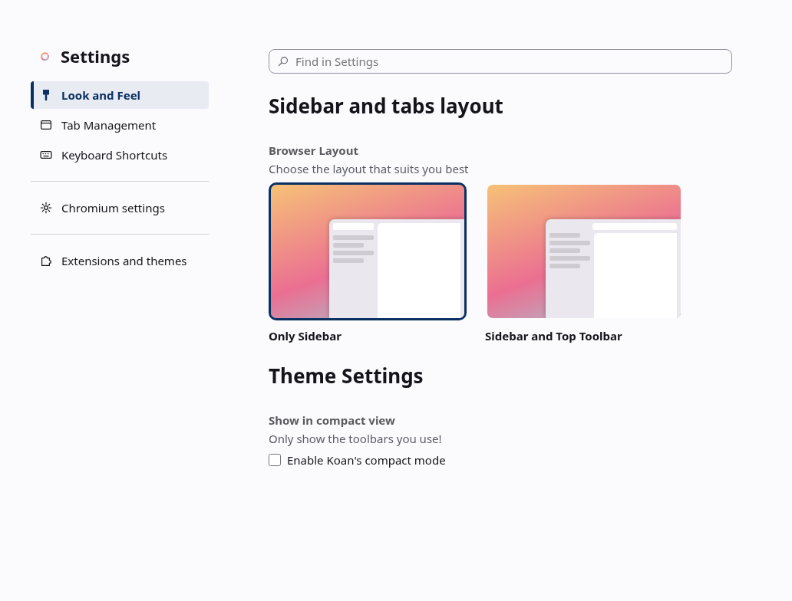

## Memory and power

Koan is set up to stay light (details in `PERFORMANCE.md`):

- **Tabs restore on demand**: after a restart, or when you reopen a closed
  window, only the tab you see loads; the others load when you open them,
  as in Zen.
- **Memory Saver is on**: a tab hidden for 4 hours (for example in a Space
  you haven't used) is unloaded and reloads when you open it. Pinned tabs,
  tabs playing audio and sites you exempt are kept. Change it, or add
  exceptions, in Settings > Performance.
- **Background tabs freeze**: apart from the 5 tabs you used last, tabs in
  the background stop running (they wake for a few seconds each minute).
  Pinned tabs never freeze, nor do tabs that played audio in the last hour
  (so media keys still work), are in a call, use a device or show
  notifications; that holds under energy saver too. Sites on Settings > Performance > "Always keep these
  sites active" never freeze either. Turn freezing off in Koan's settings
  (`chrome://koan-settings`, Tab Management > Performance).
- **Energy saver** works as in Chrome: on a MacBook it turns on below 20 %
  battery (Settings > Performance > Energy saver).

## Library

Zen's Library: press Alt+Shift+L or click the Library button (the box with
sparkles, at the start of the sidebar's bottom bar, before the Space
buttons). It slides in over the sidebar
with three sections down its side, and opens on the one you used last:

- **Downloads** (Ctrl+Shift+Y): every download, newest first, with its size,
  site and date (hover a row for where it came from). Search, or filter by
  file type (images, video, audio, documents, archives, apps) and date.
  Hover or focus a row for cancel / retry / show in folder and **⋯** (open,
  cancel, retry, copy the file or its link, remove from the list, delete
  the file after asking); right-click or the menu key opens the same menu.
  Click a finished download to show it in the file manager, or open it from
  **⋯** (a download in progress isn't set to open when done: a file only
  opens when you open it). A download Chrome warns about (dangerous or
  insecure) is never opened from here: clicking it shows Chrome's warning,
  where you keep or delete it. While anything downloads, the Downloads tab
  shows a progress ring. Right-click the Downloads tab to clear the list or open
  `chrome://downloads`.
- **Spaces**: a card per Space with its tabs, tinted with its theme. Click
  the name to rename it, the icon for the Spaces' emoji picker, the brush
  for Edit Theme; drag the arrows at the bottom to reorder the Spaces (the
  bottom bar follows). **⋯** has Change Icon, Edit Theme, Unload Space,
  Unload All Other Spaces, Create Space and Delete Space (it asks, and not
  for the only Space). **+** after the last card, like Create Space, closes
  the Library and opens the Create-a-Space form. Click a tab to go there.
  The Library widens to fit the cards.
- **History** (Ctrl+H): the last 120 days by day. Search, or **Filter**:
  when (today since midnight, this week, this month), sort (by date, site, most visited,
  last visited) and what to look through (history or the tabs closed
  recently). Click a page to open it in a new tab; Ctrl+click or
  middle-click opens it in the background and keeps the Library open.
  Hover a row for its visit time and the forget / reopen buttons;
  right-click for "Forget About This Site" (its history, cookies, site data
  and cache). Right-click the History tab to clear history from the last
  hour, 12 hours, today, week, month or everything (it asks first, naming
  the range), or to open `chrome://history`. Where policy forbids deleting
  history (AllowDeletingBrowserHistory) nothing here offers to, as on
  Chrome's History page.

Esc, the back arrow at the bottom of the side column, the same shortcut
again or opening a tab closes the Library. Incognito windows have no
Library: there Ctrl+H shows Chrome's notice that history isn't saved, as
in Chrome, and the Downloads key opens `chrome://downloads`.
With "Reduce motion" set in the system, it opens and closes without
sliding.

## Media

When a tab in the background plays music or video, a card appears at the
bottom of the sidebar, as in Zen (macOS Now Playing and the media keys
control the same media): the site's icon, previous / play-pause / next and
mute. Hover it for the title and artist, the progress (click or drag to
seek), picture-in-picture and close. Click the card (or the icon) to go to
its tab, in its Space; the card hides while that tab is selected. Up to
three cards stack, the newest in front. Close pauses the media and
dismisses its card. From the keyboard, Tab into a card to expand it; on the
progress bar Left/Right seek by 5 seconds, Home/End jump to the ends.

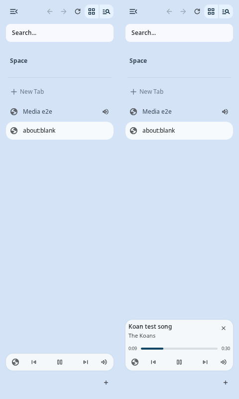

## Downloads

With the system's reduced motion setting on, Koan skips its animations
(the download animation, the welcome screen's, the media cards' fades).

Starting a download sends a small download icon flying from where you
clicked to the Library button at the bottom of the sidebar (or the
downloads button, with the toolbar showing and no Library button). While
compact mode hides the sidebar, it lands on a tile with the Library icon
that slides in at the bottom corner on the sidebar's side for a moment.

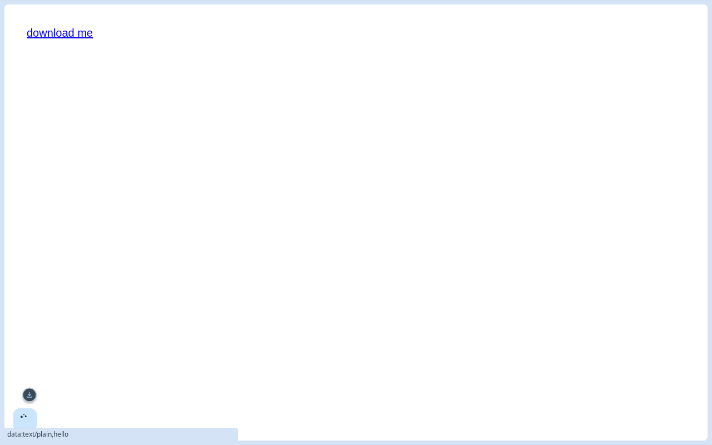

## Moving the window

Drag empty space at the very top of a page (the top 5%) to move the window,
like a title bar, as in Zen. Text, links, buttons, videos and anything else
on the page that you can click or select keep working as usual; a click
there is still a click. Turn it off in Settings > Look and Feel > Window
dragging.

## Welcome

The first time Koan starts with a new profile it shows Zen's welcome
screen: "Welcome to a calmer internet", then a few pages to import from
another browser, pick a colour, choose the search engine and your
Essentials, and make Koan the default browser. Every page can be skipped
with Next. It shows once (start Koan with `--force-first-run` and a new user data
directory to see it again). Tab moves between its buttons, the arrow keys
between choices, Enter or Space picks, and Esc skips the rest. The window's
own buttons stay usable above it.

| | |
|---|---|
| 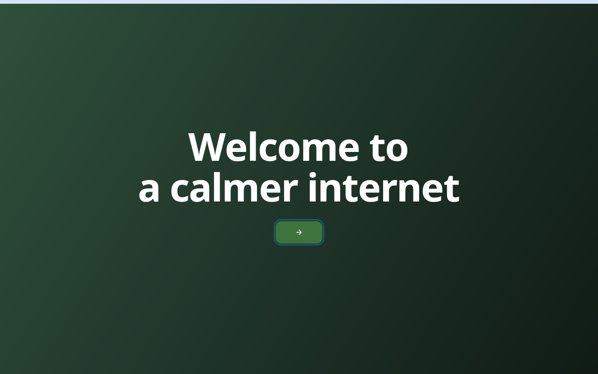 | 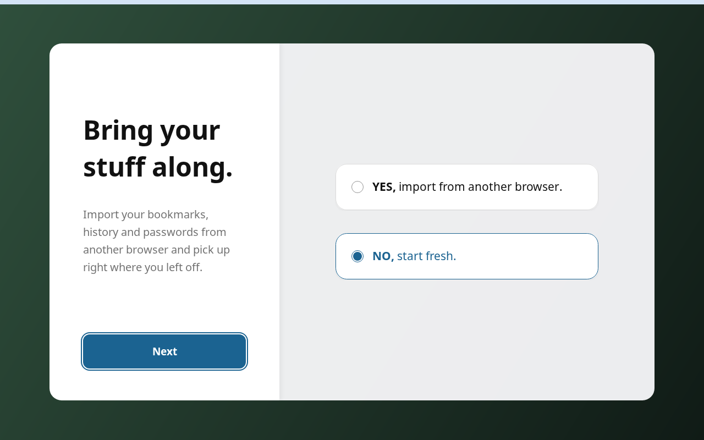 |

## Turning things off

Every Koan feature has a switch in `chrome://flags` (search "Koan"): Koan
sidebar, compact mode, workspaces, Glance, restore tabs on demand, freeze
background tabs, command palette, pinned tabs and Essentials, Library, media
controls, download animation, window dragging from pages, welcome screen.

The media controller and the download animation are on by default; like
Zen's (which keeps them in about:config), they have no setting yet, only
the prefs `koan.media_controls.enabled` and
`koan.downloads.download_animation`.

In compact mode with the sidebar hidden, a tab a page opens in the
background shows Zen's "New background tab opened!" toast; its button
switches to the tab. Renaming a Space in its header shows "Workspace has
been successfully renamed!".

Scrollbars are thin overlay bars that show while you scroll, like Zen's. For
classic, always-visible scrollbars start Koan with
`--disable-features=OverlayScrollbar`.

## Install in the app menu

```sh
scripts/install_desktop.sh               # adds Koan + icon for this user
scripts/install_desktop.sh --uninstall
```

Koan keeps its profile in `~/.config/koan`, separate from Chromium's.
