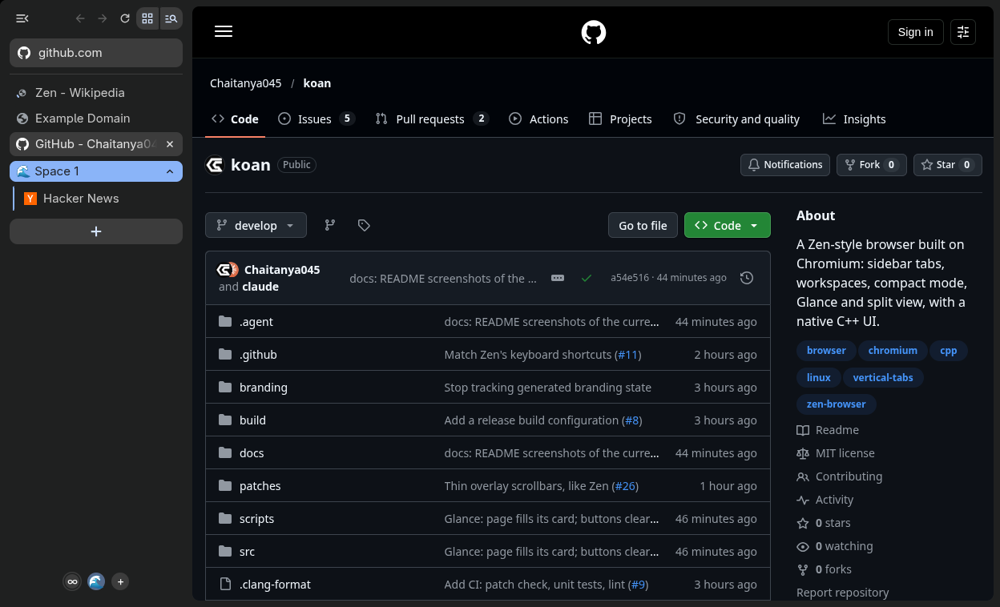
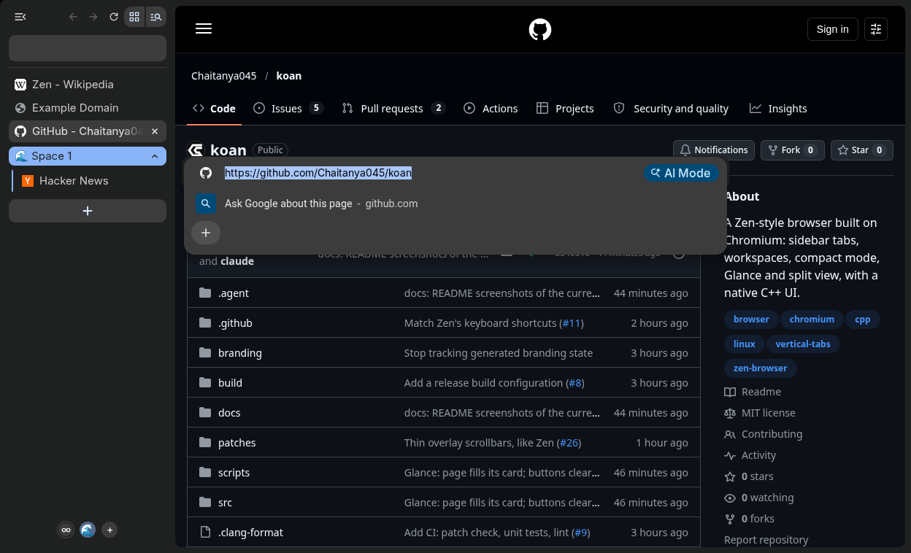
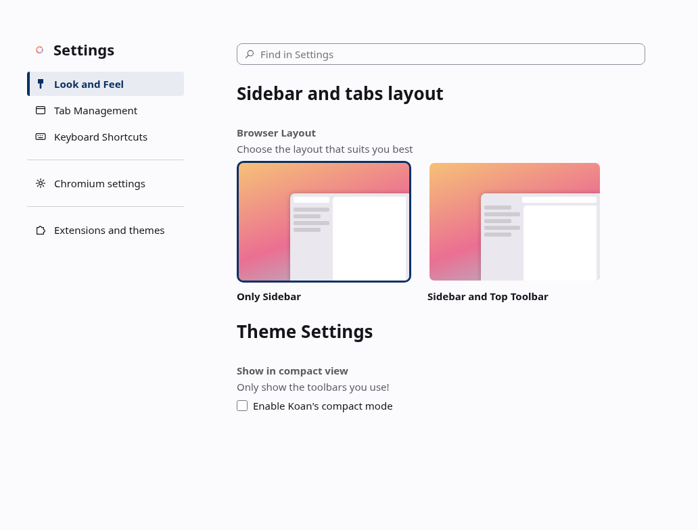

# Using Koan

Koan is Chromium with Zen's way of working: tabs in a sidebar, the page as a
floating card, workspaces, Glance and compact mode. Everything web-facing is
plain Chromium (rendering, DevTools, extensions, `chrome://` pages).

## Shortcuts

Koan uses Zen's default shortcuts (Zen shortcuts version 21, Linux). Where
Zen deliberately rebinds a key that Chrome uses, Koan follows Zen; the
"Chrome had" column says what moved. Everything not listed behaves as in
Chrome.

| Action | Keys | Chrome had |
|---|---|---|
| Toggle compact mode | Ctrl+S | Save page (now Ctrl+Alt+Shift+S) |
| Show the sidebar in compact mode | Ctrl+Alt+S | |
| Next / previous workspace | Ctrl+Alt+Right / Ctrl+Alt+Left | |
| Split view: side by side | Ctrl+Alt+V | |
| Split view: stacked | Ctrl+Alt+H | |
| Split view: grid (two panes in Chromium) | Ctrl+Alt+G | |
| Unsplit | Ctrl+Alt+U | |
| New split with an empty tab | Ctrl+Shift+* | |
| Copy the page's URL | Ctrl+Shift+C | Inspect element (now Ctrl+Shift+L) |
| Copy the page's URL as Markdown | Ctrl+Shift+Alt+C | |
| Pin / unpin tab | Ctrl+Shift+D | Bookmark all tabs |
| Close all unpinned tabs (in the workspace; keeps the selected one; Ctrl+Shift+T reopens the last closed tab, one per press) | Ctrl+Shift+K | |
| Expand Glance to a tab | Ctrl+O while Glance is open | Open file (still, otherwise) |
| Glance a link | Alt+click | (Alt+click downloaded the link) |
| Close Glance | Esc, or click the dimmed page | |
| Save page | Ctrl+Alt+Shift+S | |
| Library (history) | Alt+Shift+L | |
| Inspect element | Ctrl+Shift+L | |
| New window | Ctrl+Shift+N | New incognito window |
| New private window | Ctrl+Shift+P | Print using system dialog |
| Mute site | Ctrl+M | |
| Bookmarks | Ctrl+B | |
| Downloads | Ctrl+Shift+Y | |
| Reading mode | Ctrl+Alt+R | |
| Edit the address (floating URL bar) | Ctrl+L, or click the URL pill | |
| **Koan only:** switch single / multiple toolbars | Ctrl+Alt+B | |
| **Koan only:** new workspace | Ctrl+Alt+N | |
| Koan settings (Zen's "Open Preferences") | Ctrl+, | |

Change any of them in Settings > Keyboard Shortcuts (below).

When a page uses a key itself (for example Ctrl+S in an online editor), the
page gets it first, as in every browser.

## Layout

Koan starts in Zen's default layout, **single toolbar**: there is no toolbar
across the top, and the page reaches the top of the window. The top row of
the sidebar has the sidebar toggle, back / forward / reload and the tab
groups / tab search buttons; below it is a pill with the current site.



Click the pill or press Ctrl+L to edit the address: like Zen's, the URL bar
floats in a card centred over the window (two thirds of its width, at most
750 px) with the suggestions under it, and the pill is empty meanwhile. Esc
(twice when suggestions are showing), a click on the page or opening a
result closes it.



As in Zen, nothing sits above the page but a thin margin: move the pointer
to the top edge of the window to show the window buttons (close, ...); the
page moves down to make room and back up when you leave.

Ctrl+Alt+B switches to the multiple-toolbars layout (a toolbar above the
page, as in Chrome) and back. The layout applies to all windows and
persists.

## Sidebar

Vertical tabs are on by default, laid out like Zen's. Pinned tabs are
Koan's Essentials: square tiles at the top, up to four across, shared by
every workspace. Below them a thin line separates the tabs; **+ New Tab**
opens a tab at the top of the workspace's tabs, and the tabs follow. A
tab's close button shows while you point at it.

While the pointer is over the sidebar, **↓ Clear** appears at the end of
the line: it closes the workspace's unpinned tabs except the selected one
and any playing sound (if those are all there is, it closes them too), the
same as Ctrl+Shift+K. The workspace stays (an emptied one gets a fresh
tab), and a toast reminds you that Ctrl+Shift+T reopens them, the last
closed tab first, one per press. In the **∞** view Clear only closes tabs
that are in no workspace (the line stays while workspace tabs are listed).

Drag the sidebar's edge to resize it (163 to 500 px, as in Zen). The
workspace switcher is at the bottom of the sidebar: **∞** shows all tabs,
one round button per workspace, **+** creates one.

## Workspaces

A workspace is a tab group shown on its own. Its icon in the switcher is
the emoji its name starts with (new workspaces get one, e.g. "🌊 Space 1").
Rename or recolour a workspace from its group header's menu; renaming
changes the icon too. New tabs open in the active workspace.
Workspaces and the active one are restored on restart (Koan restores the
previous session by default; change it in Settings > On startup).

## Compact mode

Ctrl+S hides the sidebar; the page fills the window with a thin margin.
Move the pointer to the left edge (or press Ctrl+Alt+S) to slide the
sidebar out, with its navigation buttons and URL pill. Ctrl+L opens the
floating URL bar as usual. The setting applies to all windows and persists.

In the multiple-toolbars layout compact mode hides the toolbar as well;
move the pointer to the top edge to slide it down.

## Glance

Alt+click a link (or Alt+Enter on a focused link) to preview it in a card
over the page, as in Zen. Shift+click opens a new window, as in Zen and
Firefox. Same-site links with a `download` attribute still download;
cross-site ones open in Glance (Chromium ignores `download` across sites,
so there Alt+click was the only way to download). Beside the card:
close, **expand to a tab**, or **open in split view** with the current tab.

## Settings

`chrome://koan-settings` (or Ctrl+,) has Koan's settings, laid out like
Zen's preferences; everything else is in Chromium's own settings, linked
from its sidebar.

- **Look and Feel**: the browser layout (Only Sidebar / Sidebar and Top
  Toolbar) and compact mode.
- **Tab Management**: whether the active workspace tints the browser, and
  Zen's tab behaviours (Zen's defaults):
  - closing a tab switches to the **most recently used** tab rather than a
    neighbour (on);
  - **Back** in a tab with no history (one opened from a link in another
    tab) closes it and returns to that tab (on; never for pinned tabs);
  - **Ctrl+Tab** (and Ctrl+Page Up/Down) cycles within the Essentials or
    within the other tabs, whichever you are on (off), and can skip tabs
    that haven't loaded yet (off). If "Cycle through the most recently used
    tabs with Ctrl+Tab" is on in Chromium's settings (Appearance), Ctrl+Tab
    follows that instead, as the page notes; Ctrl+Page Up/Down still follow
    Koan's settings.
- **Keyboard Shortcuts**: Zen's shortcut editor. Click a shortcut, type
  the new keys and press **Esc** to save them; **Backspace** clears the
  shortcut, **Tab** leaves it unchanged. A key another shortcut already
  uses is refused ("Conflicts with ..."), and so are Ctrl+Tab and
  Ctrl+Page Up/Down, which switch tabs. A key needs Ctrl, Alt or Win
  (or is a function key). **Reset to Default** restores Zen's keys.
  Shortcuts for features switched off in `chrome://flags` aren't listed.

Changes apply at once to every window, private windows included (they
share the regular profile's settings), and the page follows changes made
elsewhere (e.g. Ctrl+S or Ctrl+Alt+B). From a private window, Ctrl+, opens
the page in a regular one, like Chromium's settings.



## Memory and power

Koan is set up to stay light (details in `PERFORMANCE.md`):

- **Tabs restore on demand**: after a restart, or when you reopen a closed
  window, only the tab you see loads; the others load when you open them,
  as in Zen.
- **Memory Saver is on**: a tab hidden for 4 hours (for example in a Space
  you haven't used) is unloaded and reloads when you open it. Pinned tabs,
  tabs playing audio and sites you exempt are kept. Change it, or add
  exceptions, in Settings > Performance.
- **Background tabs freeze**: apart from the 5 tabs you used last, tabs in
  the background stop running (they wake for a few seconds each minute).
  Pinned tabs never freeze, nor do tabs that played audio since you last
  looked at them (so media keys still work), are in a call, use a device or
  show notifications. Sites on Settings > Performance > "Always keep these
  sites active" never freeze either.
- **Energy saver** keeps Chromium's default, which never turns it on on
  Linux (as in Zen, which has none).

## Turning things off

Every Koan feature has a switch in `chrome://flags` (search "Koan"):
Koan sidebar, compact mode, workspaces, Glance, restore tabs on demand,
freeze background tabs.

Scrollbars are thin overlay bars that show while you scroll, like Zen's. For
classic, always-visible scrollbars start Koan with
`--disable-features=OverlayScrollbar`.

## Install in the app menu

```sh
scripts/install_desktop.sh               # adds Koan + icon for this user
scripts/install_desktop.sh --uninstall
```

Koan keeps its profile in `~/.config/koan`, separate from Chromium's.
