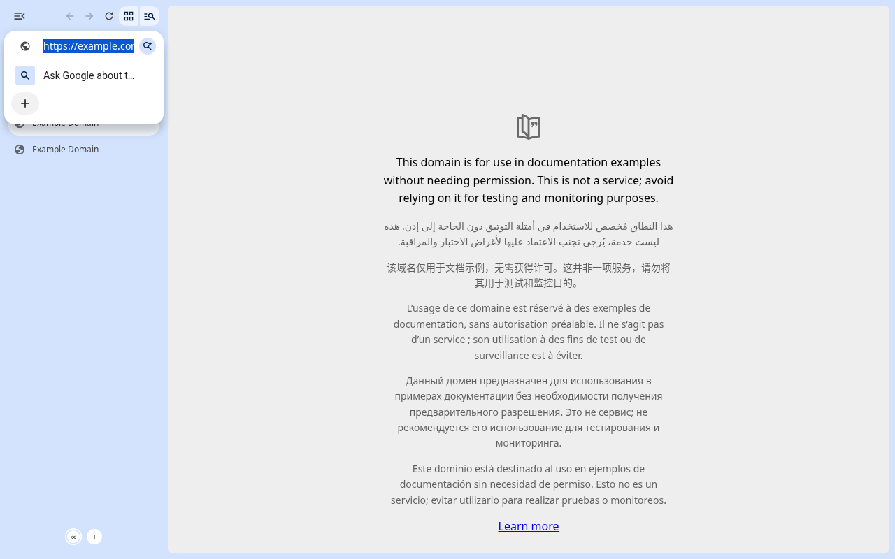
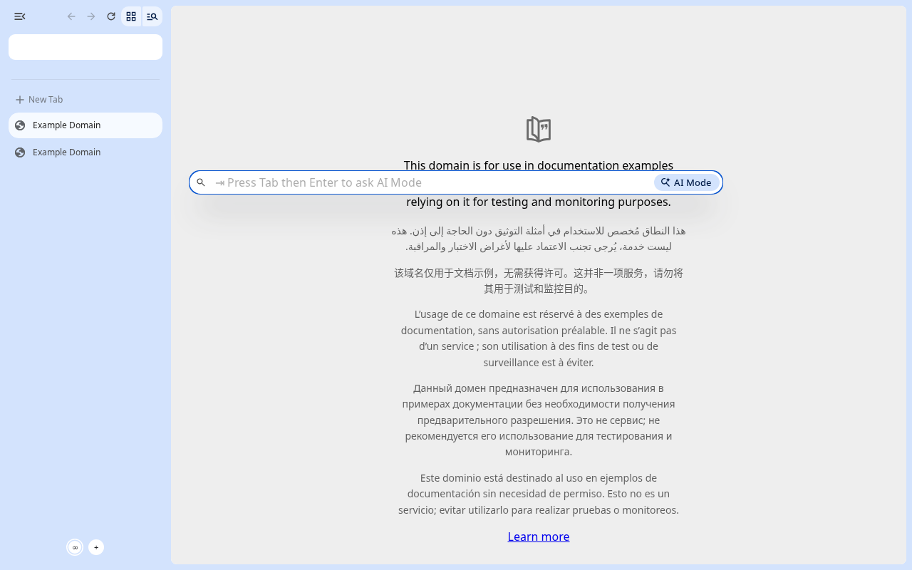
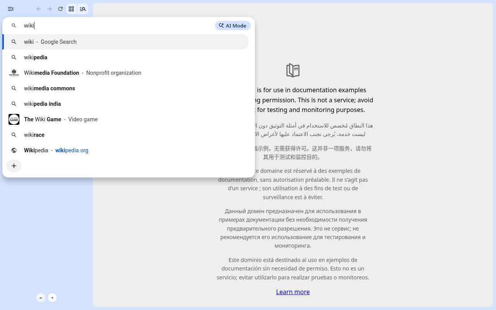
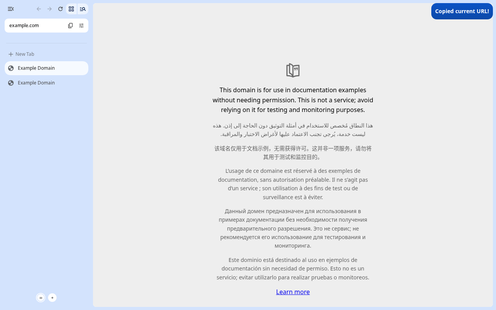
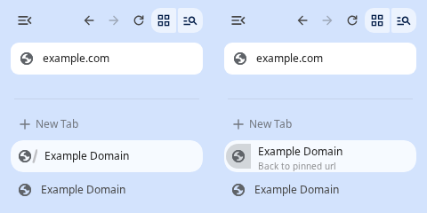

# Using Koan

Koan is Chromium with Zen's way of working: tabs in a sidebar, the page as a
floating card, workspaces, Glance and compact mode. Everything web-facing is
plain Chromium (rendering, DevTools, extensions, `chrome://` pages).

## Shortcuts

Koan uses Zen's default shortcuts (Zen shortcuts version 21, Linux). Where
Zen deliberately rebinds a key that Chrome uses, Koan follows Zen; the
"Chrome had" column says what moved. Everything not listed behaves as in
Chrome.

| Action | Keys | Chrome had |
|---|---|---|
| Toggle compact mode | Ctrl+S | Save page (now Ctrl+Alt+Shift+S) |
| Show the sidebar in compact mode | Ctrl+Alt+S | |
| Next / previous workspace | Ctrl+Alt+Right / Ctrl+Alt+Left | |
| Split view: side by side | Ctrl+Alt+V (⌘⌥V) | |
| Split view: stacked | Ctrl+Alt+H (⌘⌥H) | macOS: Hide Others |
| Split view: grid (two panes in Chromium: side by side) | Ctrl+Alt+G (⌘⌥G) | |
| Unsplit | Ctrl+Alt+U (⌘⌥U) | macOS: View Source (still in the View menu) |
| New split with an empty tab | Ctrl+Shift+* (⌘⇧*) | |
| New tab (opens the URL bar; the tab opens with what you pick) | Ctrl+T (⌘T) | New-tab page |
| Copy the page's URL | Ctrl+Shift+C (⌘⇧C) | Inspect element (now Ctrl+Shift+L) |
| Copy the page's URL as Markdown | Ctrl+Shift+Alt+C | |
| Pin / unpin tab (pinned to its workspace) | Ctrl+Shift+D | Bookmark all tabs |
| Close tab; a pinned tab or Essential instead goes back to its pinned URL, unloads and switches away | Ctrl+W, Ctrl+F4 (⌘W) | |
| Close all unpinned tabs (in the workspace; keeps the selected one; Ctrl+Shift+T reopens the last closed tab, one per press) | Ctrl+Shift+K | |
| Expand Glance to a tab | Ctrl+O (⌘O) while Glance is open | Open file (still, otherwise) |
| Glance a link | Alt+click (⌥+click; trigger method in Koan's settings) | (Alt+click downloaded the link) |
| Close Glance | Esc (twice while typing in the page), or click the dimmed page | |
| Save page | Ctrl+Alt+Shift+S | |
| Library (history) | Alt+Shift+L | |
| Inspect element | Ctrl+Shift+L | |
| New window | Ctrl+Shift+N | New incognito window |
| New private window | Ctrl+Shift+P | Print using system dialog |
| Mute site | Ctrl+M | |
| Bookmarks | Ctrl+B | |
| Downloads | Ctrl+Shift+Y | |
| Reading mode | Ctrl+Alt+R | |
| Edit the address | Ctrl+L, or click the URL pill | |
| **Koan only:** switch single / multiple toolbars | Ctrl+Alt+B | |
| **Koan only:** new workspace | Ctrl+Alt+N | |
| Koan settings (Zen's "Open Preferences") | Ctrl+, | |

Change any of them in Settings > Keyboard Shortcuts (below).

When a page uses a key itself (for example Ctrl+S in an online editor), the
page gets it first, as in every browser.

## Layout

Koan starts in Zen's default layout, **single toolbar**: there is no toolbar
across the top, and the page reaches the top of the window. The top row of
the sidebar has the sidebar toggle, back / forward / reload and the tab
groups / tab search buttons; below it is a pill with the current site.


Click the pill or press Ctrl+L to edit the address (see [URL bar](#url-bar)).

As in Zen, nothing sits above the page but a thin margin: move the pointer
to the top edge of the window to show the window buttons (close, ...); the
page moves down to make room and back up when you leave. When the buttons
are on the sidebar's side of the window (e.g. GNOME's buttons with tabs on
the right, or a "close,minimize,maximize:" button layout with tabs on the
left), they stay in the sidebar's top row instead, as in Zen.

Ctrl+Alt+B switches to the multiple-toolbars layout (a toolbar above the
page, as in Chrome) and back. The layout applies to all windows and
persists.

**Collapsed sidebar**: the sidebar toggle (left end of its top row)
collapses the sidebar to icons, Zen's "Collapsed Sidebar" layout: the
toolbar sits above the page, and the sidebar expands over the page while
the pointer is on it (right-click the toggle to turn that off). Like Zen,
single toolbar needs the full sidebar: the toggle or Ctrl+Alt+B expands it
into single toolbar again.

**Tabs on the right**: right-click an empty part of the sidebar and pick
**Tabs on the right** (or Settings > Look and Feel > Vertical Tabs).
Everything mirrors: the sidebar is on the right, its top row and resize
edge too, and compact mode reveals it at the right edge. (In a
right-to-left UI, where the sidebar is normally on the right, it goes to
the left.)

On macOS the window buttons (traffic lights) stay at the top left: Koan
can't hide them yet, so with the sidebar hidden or on the right they sit
over the page's corner.

## URL bar

Like Zen's, the URL bar opens where you are and floats once you type:
clicking the pill (or Ctrl+L) edits the address right in the pill; the
first keystroke lifts it into a card centred over the window (two thirds
of its width, at most 750 px, larger text, a soft shadow over the page)
with the suggestions under it. The pill is empty meanwhile. Esc, a click
outside the card or opening a result (or running an action) closes it;
switching to another window and back leaves it as it was. In compact mode,
with the sidebar hidden, it floats right away, also when you click the pill
of the peeked sidebar.

| Editing in the pill | Floating once you type | Ctrl+T |
|---|---|---|
|  |  |  |

**Ctrl+T** (⌘T; also the sidebar's **+ New Tab** and the menus' New Tab)
opens the URL bar, empty, instead of a new-tab page: the tab opens only
when you open something from it, in a new tab next to the current one.
(With Chromium's horizontal tabs, the tab strip's **+** still opens a
new-tab page.) Esc, a click outside or Ctrl+T again closes it without
creating anything; what you had typed comes back if you press Ctrl+T again
within 45 seconds.

Hover the pill (or Tab to it) for the **copy** button: it copies the page's
URL and says so ("Copied current URL!"), as do Ctrl+Shift+C and
Ctrl+Shift+Alt+C (Markdown link; ⌘⇧C and ⌘⇧⌥C on macOS). The button at the end of the pill
opens the site's panel (security, permissions, cookies and site settings).

| "Normal": editing in place, widened | Copied |
|---|---|
|  |  |

Settings, in Koan's settings (Ctrl+,) under Look and Feel > URL Bar
(profile prefs, Zen's names in brackets):

| Setting | Pref | Default |
|---|---|---|
| Behavior: **Normal** (always edit in the pill; it widens over the page while you type), **Floating only when typing** (as above), **Always floating** | `koan.urlbar.behavior` (`zen.urlbar.behavior`) | Floating only when typing |
| Open the URL bar instead of a new tab page | `koan.urlbar.replace_newtab` (`zen.urlbar.replace-newtab`) | on |
| Show the copy URL button | `koan.urlbar.show_copy_url` (`zen.urlbar.single-toolbar-show-copy-url`) | on |

In the multiple-toolbars layout the address is edited in the toolbar, as
in Chrome; Ctrl+T still opens it instead of a new-tab page, and Esc closes
it in one press.

## Command palette

As in Zen, the URL bar runs actions too. Type three or more letters of an
action ("compact", "pin tab", "dark") and up to three matching actions
appear right below the first suggestion, with their shortcut; pick one with
the arrow keys and Enter, or click it. An action you have run comes first
the next time, and typing its whole name ("toggle compact mode") makes Enter
run it; actions you keep passing over drop below the search suggestions.
Typing the start of an address still opens the site.

To see every action, press Tab in an empty URL bar (Ctrl+L, Backspace,
Tab) or type `>`; Tab again leaves. Typing filters the list, and once you
have typed two letters Enter runs the first match.

The actions, with Zen's names: Toggle Compact Mode, New Split View, Expand
current view (unsplit), Copy Current URL, Settings, Open Private Window,
Open New Window, Pin / Unpin Tab, Add to / Remove from Essentials, Close
Tab, Reopen Closed Tab, Duplicate Current Tab, Reload Tab, Reload Tab
Without Cache, Next / Previous Tab, Capture Screenshot, Find in Page, Manage
Extensions, Switch to Automatic Appearance / Light Mode / Dark Mode, Print;
with workspaces also New Space, Next / Previous Space and "Focus on" each
other Space (type its name). Only the actions that apply are offered (Unpin
Tab on a pinned tab, Next Space with two Spaces, ...).

## Sidebar

Vertical tabs are on by default, laid out like Zen's. The
**Essentials** are square tiles at the top, up to four across, shared by
every workspace. Below them a thin line separates the tabs; **+ New Tab**
opens a tab at the top of the workspace's tabs, and the tabs follow. A
tab's close button shows while you point at it.

While the pointer is over the sidebar, **↓ Clear** appears at the end of
the line: it closes the workspace's unpinned tabs except the selected one
and any playing sound (if those are all there is, it closes them too), the
same as Ctrl+Shift+K. The workspace stays (an emptied one gets a fresh
tab), and a toast reminds you that Ctrl+Shift+T reopens them, the last
closed tab first, one per press. In the **∞** view Clear only closes tabs
that are in no workspace (the line stays while workspace tabs are listed).

Drag the sidebar's edge to resize it (163 to 500 px, as in Zen). The
workspace switcher is at the bottom of the sidebar: **∞** shows all tabs,
one round button per workspace, **+** creates one.

Right-clicking an empty part of the sidebar opens Zen's toolbar menu:
**Compact Mode** (below) and **Tabs on the right**. Dragging the sidebar's
edge resizes it; dragging it closed hides it in compact mode, as in Zen
("Sidebar hidden! Use Ctrl+S to bring the sidebar back", shown once). If
compact mode was set to hide just the toolbar, the drag makes it hide both.

## Pinned tabs and Essentials

As in Zen there are two kinds of pinned tab:

- **Pinned tabs** belong to their workspace and stay at the top of its
  tabs. Pin a tab with Ctrl+Shift+D or "Pin" in its context menu.
- **Essentials** are shared by all workspaces, up to 12 per window: "Add to
  Essentials" in the tab's context menu shows how many are used ("3 / 12").
  Dragging a tab into the grid also makes it an Essential.

Both remember the URL they were pinned on, the **pinned URL**. When a pinned
tab goes elsewhere, a slash appears after its icon: hover it to see the
pinned page's icon and "Back to pinned url", click to go back (Ctrl+click
first moves the current page to a new tab). The context menu also has
"Reset Pinned Tab", "Replace with Current URL" and "Edit Pinned URL…"
("…Essential…" for Essentials).



Closing a pinned tab or an Essential (Ctrl+W, its close button, a middle
click) doesn't close it: like Zen, it goes back to its pinned URL, is
unloaded to free memory and the next tab is selected. A pinned tab that is
already unloaded closes from its close button. Settings > Tab Management >
Pinned Tabs has Zen's choices for what closing does, and "Restore pinned
tabs to their originally pinned URL on startup" (off by default, as in
Zen). Pinned tabs, like Essentials, are never frozen in the background,
and Close Other Tabs, Close Tabs Below and Back in a tab with no history
leave them open. Drag a pinned tab below the other tabs to unpin it, or a
tab among the pinned ones to pin it. With several pinned tabs selected,
Ctrl+W does the same to each of them and closes none of the others.

Any tab's context menu has "Change Label…" (edit the name in place; Enter
keeps it, Esc cancels, an empty name goes back to the page title), "Change
Icon…" (an emoji instead of the favicon) and "Unload" (free the tab's
memory; it reloads when you select it). Pinned URLs, labels and icons are
kept with the session.

## Workspaces

A workspace is a tab group shown on its own. Its icon in the switcher is
the emoji its name starts with (new workspaces get one, e.g. "🌊 Space 1").
Rename or recolour a workspace from its group header's menu; renaming
changes the icon too (the colour is the switcher button's; the window's
look comes from the Space theme below). New tabs open in the active workspace.
Workspaces and the active one are restored on restart (Koan restores the
previous session by default; change it in Settings > On startup).

## Space themes

Every workspace (Space) has its own gradient theme, as in Zen. Right-click a
Space in the switcher (or **∞** for "All tabs") and choose **Edit Theme…**,
or run **Open Theme Picker** from the command palette (for the active
Space), to open Zen's theme picker beside the sidebar:

- **Colour field**: click to place a colour, drag the big dot to change it,
  right-click it to remove it. Up to three colours.
- **+ / − / harmony**: add or remove a colour; the third button cycles the
  colour harmony (Complementary, Split, Analogous, Triadic, Floating) that
  places the other dots around the big one.
- **Presets**: five pages of Zen's preset swatches (arrows to page).
- **Opacity**: the wave slider; a flatter wave is a lighter tint.
- **Grain**: drag the handle around the dial for Zen's grain texture.
- **Automatic / Light / Dark** (top of the field): the window scheme, which
  websites follow too.

From the keyboard: Tab to the field, Enter adds a colour, the arrow keys
move the big dot (Shift for bigger steps), Delete removes it; the swatches
are one Tab stop (arrows move between them, Space applies one); the opacity
slider and the grain dial take the arrow keys, Home and End.

Changes show on the window at once and are saved when the panel closes.
The window's sidebar, toolbar and the margin around the page show the
gradient; switching Spaces cross-fades to the next Space's gradient. A
theme also decides whether the window's own colours are light or dark and
sets their accent, like Zen; websites keep following the appearance setting.

The Space menu also has **Appearance** (what websites use: Automatic, Light
or Dark; the palette's "Switch to ... Appearance / Mode" do the same).
**Settings > Look and Feel > Dark Theme Styles** picks Default, Night (a
black window) or Colorful (dark surfaces tinted with the accent); Night and
Colorful are Koan's own (Zen has only the setting's name so far).
**Settings > Tab Management > Workspaces** turns Space themes off. The
custom colour list of Zen's picker is off by default, as in Zen; turn it on
with the pref `koan.theme.gradient.show_custom_colors`.

With a Chrome Web Store theme installed, the theme keeps the window's look
and Space themes are off until you remove it (Settings > Appearance >
Reset to default).

## Compact mode

Ctrl+S hides the sidebar; the page fills the window with a thin margin.
Move the pointer to the left edge (or press Ctrl+Alt+S) to slide the
sidebar out, with its navigation buttons and URL pill. Ctrl+L and Ctrl+T
open the floating URL bar. The setting applies to all windows and persists.

In the multiple-toolbars layout you choose what compact mode hides, in the
sidebar's menu under **Compact Mode**: **Hide sidebar** (the default, as in
Zen), **Hide toolbar** or **Hide both**. A hidden toolbar slides down when
the pointer reaches the top edge, with the window buttons. With the sidebar
collapsed to icons and the window buttons on its side, Zen doesn't offer
hiding just the toolbar, and neither does Koan: the menu item is off, and
if hiding just the toolbar is chosen (e.g. in Settings, or before the
sidebar was collapsed), that window hides the sidebar instead. The choice
itself is kept, for the other windows and for when the sidebar is expanded
again.

The same choices are in Settings (Ctrl+,) > Look and Feel > Show in
compact view, with Zen's "Briefly make the toolbar popup when switching or
opening new tabs in compact mode" (off by default): the hidden sidebar then
pops up for a moment whenever you switch tabs.

## Glance

Alt+click a link (or Alt+Enter on a focused link) to preview it in a card
over the page, as in Zen. The card grows out of the click and shrinks back
into it when it closes; the page behind fades into the window background.
**Open Link in Glance** in the link context menu does the same. An Alt+click
on a link in the Glance page shows that link in the card. Shift+click opens
a new window, as in Zen and Firefox. Same-site links with a `download`
attribute still download.

Beside the card: close (Esc, or a click on the faded page), **Expand
Glance** to a tab (Ctrl+O; ⌘O on macOS) and **Split Glance** with the
current tab. As in Zen, while you type in the Glance page the first Esc
only turns the close button red ("Press Esc again to close"); a second Esc
within 3 seconds closes. A page that asks before you leave it ("Leave
site?") gets to ask.

On macOS, as in Zen (whose default trigger is `alt` on every platform):
Alt is the Option key, so ⌥+click opens Glance, Meta is ⌘, and the split
view shortcuts are ⌘⌥V / ⌘⌥H / ⌘⌥G / ⌘⌥U, which take over View Source
(⌘⌥U) and Hide Others (⌘⌥H) from the keyboard. Ctrl+click is a right-click
on macOS, so it isn't offered as a trigger there. On macOS the card
appears and goes without growing and shrinking (not verified on a Mac
yet).

**Settings** (Koan's settings, Look and Feel → Glance; Zen's
`zen.glance.enabled` and `zen.glance.activation-method`): **Enable Glance**,
and **Trigger method**: Ctrl + Click, Alt + Click (the default), Shift +
Click or Meta (Command) + Click. The trigger method reaches pages opened
after the change (pages already open, and new ones that share their
renderer, keep the old method until Koan restarts). With another trigger
method, a click Glance can't open (not a web link, an app window) does
what that modifier does without Glance (Ctrl: a background tab; Shift: a
window). The "Koan Glance" flag in `chrome://flags` removes Glance
altogether.

## Split view

Besides the shortcuts above:

- Tab context menu: **Add Split View...** splits the tab with the current
  one (or with a new tab, for the current tab), **Join 2 Tabs** splits a
  two-tab selection, **Split Out Tab** separates a split (Zen's labels).
  Upstream's **Arrange split view** and **Move tab into split view** stay.
- Link context menu: **Split Link to New Tab** opens the link beside the
  page; in a split, "Open link in left/right view" loads it in the other
  view.
- Drag a tab onto the left or right edge of the page to split with it
  (Chromium's split view drop targets).
- Chromium's split views have two panes (Zen's take four, in a grid): a
  third panel (Split Glance over a split, a split shortcut with more tabs
  selected) shows Zen's "Can't add more panels to the split view!" toast.

## Settings

`chrome://koan-settings` (or Ctrl+,) has Koan's settings, laid out like
Zen's preferences; everything else is in Chromium's own settings, linked
from its sidebar.

- **Look and Feel**: the browser layout (Only Sidebar / Sidebar and Top
  Toolbar), tabs on the right, compact mode, what it hides and its flash
  popup.
- **Tab Management**: whether the active workspace tints the browser,
  whether background tabs freeze (see "Memory and power"), and Zen's tab
  behaviours (Zen's defaults):
  - closing a tab switches to the **most recently used** tab rather than a
    neighbour (on);
  - **Back** in a tab with no history (one opened from a link in another
    tab) closes it and returns to that tab (on; never for pinned tabs);
  - **Ctrl+Tab** (and Ctrl+Page Up/Down) cycles within the Essentials or
    within the other tabs, whichever you are on (off), and can skip tabs
    that haven't loaded yet (off). If "Cycle through the most recently used
    tabs with Ctrl+Tab" is on in Chromium's settings (Appearance), Ctrl+Tab
    follows that instead, as the page notes; Ctrl+Page Up/Down still follow
    Koan's settings.
- **Keyboard Shortcuts**: Zen's shortcut editor. Click a shortcut, type
  the new keys and press **Esc** to save them; **Backspace** clears the
  shortcut, **Tab** leaves it unchanged. A key another shortcut already
  uses is refused ("Conflicts with ..."), and so are Ctrl+Tab and
  Ctrl+Page Up/Down, which switch tabs. A key needs Ctrl, Alt or Win
  (or is a function key). **Reset to Default** restores Zen's keys.
  Shortcuts for features switched off in `chrome://flags` aren't listed.

Changes apply at once to every window, private windows included (they
share the regular profile's settings), and the page follows changes made
elsewhere (e.g. Ctrl+S or Ctrl+Alt+B). From a private window, Ctrl+, opens
the page in a regular one, like Chromium's settings.


## Memory and power

Koan is set up to stay light (details in `PERFORMANCE.md`):

- **Tabs restore on demand**: after a restart, or when you reopen a closed
  window, only the tab you see loads; the others load when you open them,
  as in Zen.
- **Memory Saver is on**: a tab hidden for 4 hours (for example in a Space
  you haven't used) is unloaded and reloads when you open it. Pinned tabs,
  tabs playing audio and sites you exempt are kept. Change it, or add
  exceptions, in Settings > Performance.
- **Background tabs freeze**: apart from the 5 tabs you used last, tabs in
  the background stop running (they wake for a few seconds each minute).
  Pinned tabs never freeze, nor do tabs that played audio in the last hour
  (so media keys still work), are in a call, use a device or show
  notifications; that holds under energy saver too. Sites on Settings > Performance > "Always keep these
  sites active" never freeze either. Turn freezing off in Koan's settings
  (`chrome://koan-settings`, Tab Management > Performance).
- **Energy saver** works as in Chrome: on a MacBook it turns on below 20 %
  battery (Settings > Performance > Energy saver).

## Turning things off

Every Koan feature has a switch in `chrome://flags` (search "Koan"):
Koan sidebar, compact mode, workspaces, Glance, restore tabs on demand,
freeze background tabs, command palette, pinned tabs and Essentials.

Scrollbars are thin overlay bars that show while you scroll, like Zen's. For
classic, always-visible scrollbars start Koan with
`--disable-features=OverlayScrollbar`.

## Install in the app menu

```sh
scripts/install_desktop.sh               # adds Koan + icon for this user
scripts/install_desktop.sh --uninstall
```

Koan keeps its profile in `~/.config/koan`, separate from Chromium's.
